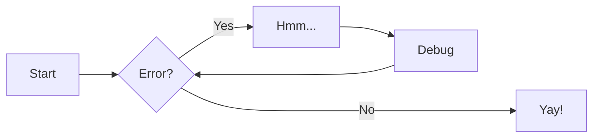

# Get started

For full documentation visit [zensical.org](https://zensical.org/docs/).

## Commands

- [`zensical new`][new] - Create a new project
- [`zensical serve`][serve] - Start local web server
- [`zensical build`][build] - Build your site

  [new]: https://zensical.org/docs/usage/new/
  [serve]: https://zensical.org/docs/usage/preview/
  [build]: https://zensical.org/docs/usage/build/

## Examples

### Admonitions

> Go to [documentation](https://zensical.org/docs/authoring/admonitions/)

!!! note

    This is a **note** admonition. Use it to provide helpful information.

!!! warning

    This is a **warning** admonition. Be careful!

### Details

> Go to [documentation](https://zensical.org/docs/authoring/admonitions/#collapsible-blocks)

??? info "Click to expand for more info"

    This content is hidden until you click to expand it.
    Great for FAQs or long explanations.

## Code Blocks

> Go to [documentation](https://zensical.org/docs/authoring/code-blocks/)

```python hl_lines="2" title="Code blocks"
def greet(name):
    print(f"Hello, {name}!") # (1)!

greet("Python")
```

1.  > Go to [documentation](https://zensical.org/docs/authoring/code-blocks/#code-annotations)

    Code annotations allow to attach notes to lines of code.

Code can also be highlighted inline: `#!python print("Hello, Python!")`.

## Content tabs

> Go to [documentation](https://zensical.org/docs/authoring/content-tabs/)

=== "Python"

    ``` python
    print("Hello from Python!")
    ```

=== "Rust"

    ``` rs
    println!("Hello from Rust!");
    ```

## Diagrams

> Go to [documentation](https://zensical.org/docs/authoring/diagrams/)



## Footnotes

> Go to [documentation](https://zensical.org/docs/authoring/footnotes/)

Here's a sentence with a footnote.[^1]

Hover it, to see a tooltip.

[^1]: This is the footnote.

## Formatting

> Go to [documentation](https://zensical.org/docs/authoring/formatting/)

- ==This was marked (highlight)==
- ^^This was inserted (underline)^^
- ~~This was deleted (strikethrough)~~
- H~2~O
- A^T^A
- ++ctrl+alt+del++

## Icons, Emojis

> Go to [documentation](https://zensical.org/docs/authoring/icons-emojis/)

- :sparkles: `:sparkles:`
- :rocket: `:rocket:`
- :tada: `:tada:`
- :memo: `:memo:`
- :eyes: `:eyes:`

## Maths

> Go to [documentation](https://zensical.org/docs/authoring/math/)

$$
\cos x=\sum_{k=0}^{\infty}\frac{(-1)^k}{(2k)!}x^{2k}
$$

!!! warning "Needs configuration"
Note that MathJax is included via a `script` tag on this page and is not
configured in the generated default configuration to avoid including it
in a pages that do not need it. See the documentation for details on how
to configure it on all your pages if they are more Maths-heavy than these
simple starter pages.

<script id="MathJax-script" src="https://unpkg.com/mathjax@3/es5/tex-mml-chtml.js"></script>
<script>
  window.MathJax = {
    tex: {
      inlineMath: [["\\(", "\\)"]],
      displayMath: [["\\[", "\\]"]],
      processEscapes: true,
      processEnvironments: true
    },
    options: {
      ignoreHtmlClass: ".*|",
      processHtmlClass: "arithmatex"
    }
  };

  document$.subscribe(() => {
    MathJax.startup.output.clearCache()
    MathJax.typesetClear()
    MathJax.texReset()
    MathJax.typesetPromise()
  })
</script>

## Task Lists

> Go to [documentation](https://zensical.org/docs/authoring/lists/#using-task-lists)

- [x] Install Zensical
- [x] Configure `zensical.toml`
- [x] Write amazing documentation
- [ ] Deploy anywhere

## Tooltips

> Go to [documentation](https://zensical.org/docs/authoring/tooltips/)

[Hover me][example]

[example]: https://example.com "I'm a tooltip!"

# **MY PROJECTS**

### **1. 2016 – 2019 | Unity Engine**

**Foundational projects and initial experiments in game development.**

##### Simple AI & Pathfinding:

##### Procedural VFX (Particle Systems):

##### First-Person Animation:

##### Immersive Gameplay Mechanics (Player States):

##### Technical Optimization (Graphics Menu):

##### Cross-Platform Input Support:

**Note:**

### **2. 2019 – 2021 | Modding Frameworks**

**Development of custom systems and multiplayer frameworks**

My key Contributions:

##### Realistic Inventory & Weapon Restriction:

##### Emergency lighting system Overhaul:

##### Dynamic fire/flame System:

##### Mask Shop System:

##### Immersive Armory & Animation Syncing:

##### Other projects & world building:

##### Custom Mapping & Level Design:

**Note:**

### **3. 2022 – 2024 | Unity Engine**

**Advanced school assignments and specialized technical explorations.**

Overview:

##### Demos

##### Extra Additions:

##### Inverse Kinematics:

##### 4. 2025 – Present | Current Works

**Ongoing focus on complex mechanics and immersive environments.**

Overview:

##### Weapon System Development in Unity:

##### VR Optimization & VRChat World Building:

**Note:**
