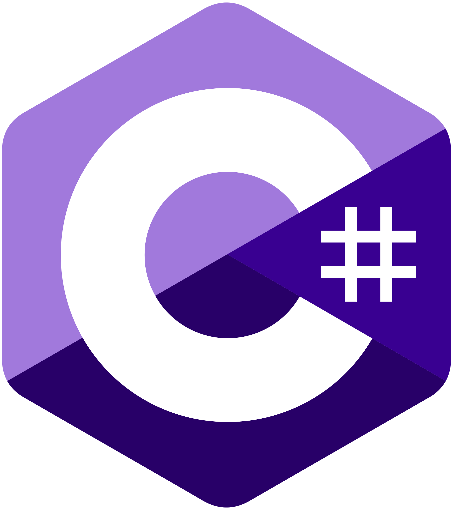
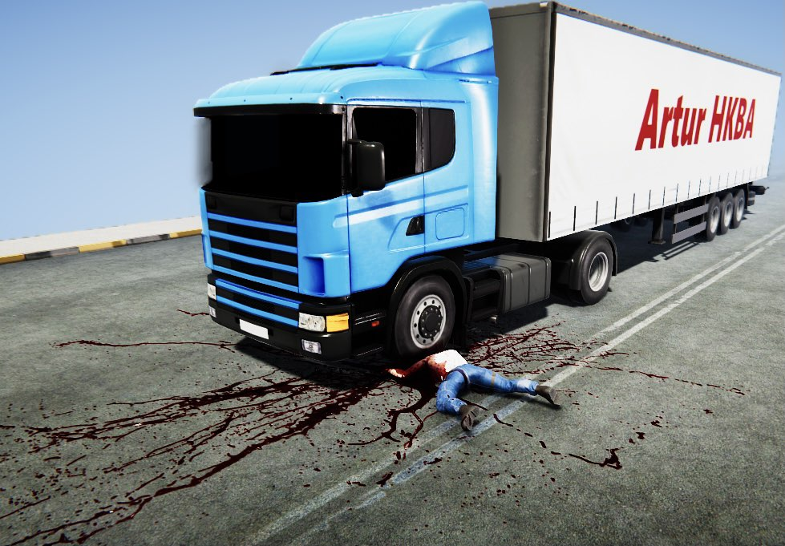
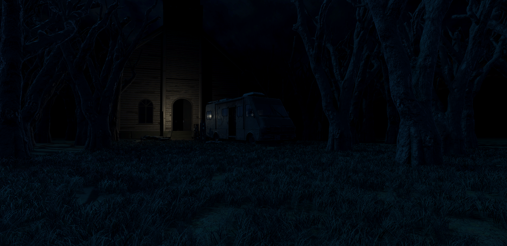
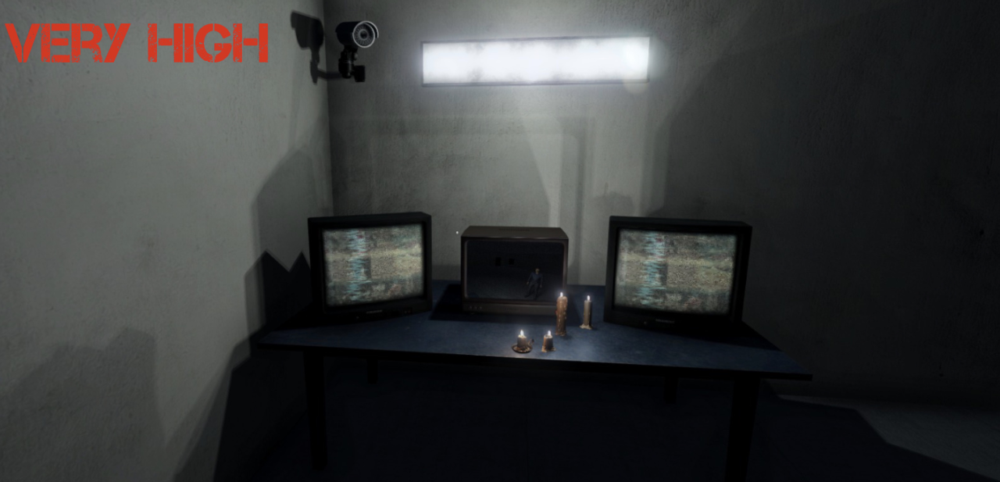
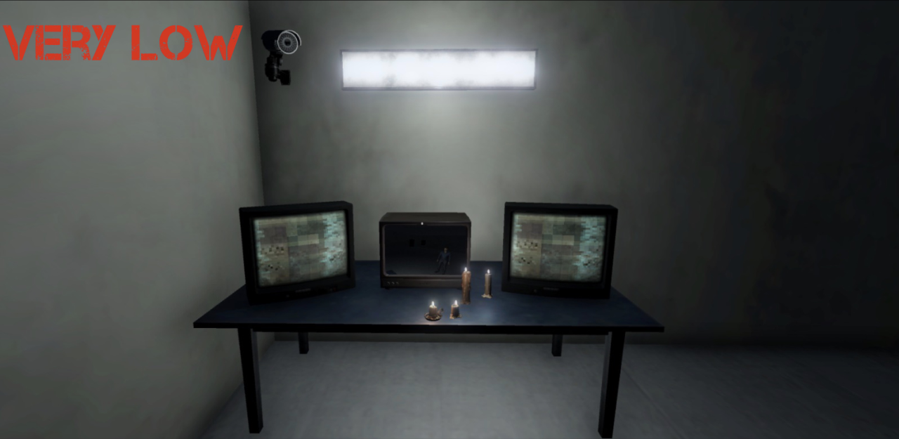
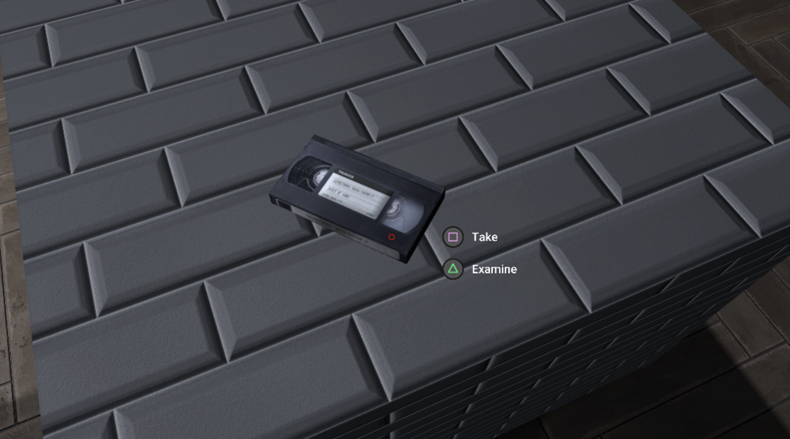

# **2016 – 2019 | Unity Engine: Early Explorations & Prototyping**

**Foundational projects and initial experiments in game development.**

**Tech Stack:**

<div class="badges-container-horizontal" style="display: flex; flex-wrap: wrap; gap: 12px; align-items: center;">

  <span class="skill-badge" style="display: inline-flex; align-items: center; width: max-content; min-width: 180px; padding: 0 12px; height: 45px;">
     
    <a href="https://unity.com" target="_blank" style="text-decoration: none; color: inherit; display: inline-flex; align-items: center; gap: 8px;">
      Unity Engine <span>↗</span>
    </a>
  </span>

  <span class="skill-badge" style="display: inline-flex; align-items: center; width: max-content; min-width: 180px; padding: 0 12px; height: 45px;">
     
    <a href="https://blender.org" target="_blank" style="text-decoration: none; color: inherit; display: inline-flex; align-items: center; gap: 8px;">
      Blender <span>↗</span>
    </a>
  </span>

  <span class="skill-badge" style="display: inline-flex; align-items: center; width: max-content; min-width: 100px; padding: 0 12px; height: 45px; color: inherit;">
     
    C#
  </span>
</div>


!!! info "Overview"
    
    While my journey into game development began in 2014, it was in 2016 that I transitioned into the Unity Engine to bring my concepts to life. During this period, I developed an independent horror project, which served as a foundation for mastering C# scripting, simple enemy AI systems and interactive environment design. The following previews showcase my early work and reflect the beginning of my passion for the creative freedom found in game development, turning complex ideas into playable experiences.


!!! danger no-icon ""

    ## :material-robot-outline: **Simple AI & Pathfinding**

    *Implemented simple enemy AI utilizing Unity’s NavMesh system and custom waypoint scripting to create dynamic patrol and chase behaviors.*

    === ":material-map-marker-path: *Enemy Waypoints*"

        *Demonstrating the dynamic patrol routine between the custom waypoint scripts.*

        <div class="media-wrapper">
          <video controls>
            <source src="../vid/Enemy_waypoints.mp4" type="video/mp4">
          </video>
        </div>

    === ":material-vector-polygon: *NavMesh Preview*"

        *Visualizing the underlying Unity NavMesh calculation and pathfinding system in action.*

        <div class="media-wrapper">
          <video controls>
            <source src="../vid/Navmesh_preview.mp4" type="video/mp4">
          </video>
        </div>


    ??? example ":material-code-braces: View Code Snippet (`SimpleAiPatrol.cs`) | :material-github: [Full Source Code on GitHub](https://github.com/ArturHKBA/ArturHKBA.github.io/tree/main/assets/resources/unity/simpleai)"

        ```csharp title="SimpleAiPatrol.cs" linenums="7"
        public class SimpleAiPatrol : MonoBehaviour
        {
            private NavMeshAgent agent;
            [SerializeField] private Vector3 firstPosOffset;
            [SerializeField] private Vector3 secondPosOffset;
            public enum AIState { Patrol, Attack, Idle}
            public AIState currentAiState;
            private FieldOfView fieldOfView;
            [SerializeField] private float viewRadius = 15f;
            [Range(0, 360)][SerializeField] private float viewAngle = 15f;
            private bool idleStop = false;
            private bool patrolMove = false;
            [HideInInspector] public bool isAttacking = false;
            private FaceObjectTowardPlayer faceTowardPlayer;
            [SerializeField] private float stopDistanceFromPlayer = 10f;
            private GegnerHealth gegnerHealth;

            void Start()
            {
                gegnerHealth = GetComponent<GegnerHealth>();
                faceTowardPlayer = GetComponentInChildren<FaceObjectTowardPlayer>();
                isAttacking = false;
                fieldOfView = GetComponent<FieldOfView>();
                fieldOfView.viewRadius = viewRadius;    
                fieldOfView.viewAngle = viewAngle;

                firstPosOffset = transform.position + firstPosOffset;
                secondPosOffset = transform.position + secondPosOffset;

                agent = GetComponent<NavMeshAgent>();
            }

            void OnDrawGizmos()
            {
                Gizmos.color = Color.green;
                Gizmos.DrawWireSphere(transform.position, stopDistanceFromPlayer);
            }

            private void LateUpdate()
            {
                switch (currentAiState)
                {
                    case AIState.Patrol:
                        Patrol();
                        break;
                    case AIState.Attack:
                        Attack();
                        break;
                    case AIState.Idle:
                        Idle();
                        break;
                }

                if(gegnerHealth.gegnerGotHit)
                {
                    currentAiState = AIState.Attack;
                }
            }

            private void Patrol()
            {
                if (!patrolMove)
                {
                    agent.SetDestination(firstPosOffset);
                }
                else
                {
                    agent.SetDestination(secondPosOffset);
                }

                if (Mathf.Abs(agent.nextPosition.z - firstPosOffset.z) <= 1 && Mathf.Abs(agent.nextPosition.x - firstPosOffset.x) <= 1)
                {
                    patrolMove = true;
                }

                if (Mathf.Abs(agent.nextPosition.z - secondPosOffset.z) <= 1 && Mathf.Abs(agent.nextPosition.x - secondPosOffset.x) <= 1)
                {
                    patrolMove = false;
                }

                SearchForPlayer();
            }
        }
        ```

<br/><br/>

!!! danger no-icon ""

    ## :material-shimmer: **Procedural VFX (Particle Systems)**

    *Exploration of collision-based particle logic and scripted asset behaviors for dynamic in-game visual feedback.*

    === ":material-water: *Dynamic Blood-Splatter*"

        *By utilizing collision detection within the Particle System, I ensured that every impact resulted in a unique visual output, avoiding repetitive "canned" animations.*

        <div class="media-wrapper">
          <video controls>
            <source src="../vid/Blood_particle.mp4" type="video/mp4">
          </video>
        </div>

    === ":material-script-text-play: *Asset Scripting*"

        <div class="media-split-grid">
        <div class="media-split-item">
          <p><em>Another scripted example using some assets to expand the procedural visual effect variety.</em></p>
          <div class="media-wrapper">
            <iframe src="https://youtube.com" allowfullscreen></iframe>
          </div>
        </div>
        <div class="media-split-item">
          <p><em>Gore Visuals &amp; Particle Sheet:</em> High-resolution overview and inspectable detail showcase of the compiled custom gore particle sheet.</p>
          <div class="media-wrapper spoiler-card" onclick="this.classList.add('revealed'); this.querySelector('a').click();">
            <a href="../img/portfolio/Gore.png" class="glightbox" style="display: block; width: 100%; height: 100%;" onclick="event.stopPropagation();">
              
            </a>
            <div class="spoiler-overlay">
              <span class="spoiler-title">:material-alert-outline: <strong>SPOILER: GORE CONTENT!</strong></span>
              <span class="spoiler-desc"><strong>This preview contains potentially disturbing scenes or explicit gore depictions. Click here to reveal and inspect the full image!</strong></span>
            </div>
          </div>
        </div>
        </div>

<br/><br/>

!!! danger no-icon ""

    ## :material-heart-pulse: **Immersive Gameplay Mechanics (Player States)**

    *Combining reactive player states with atmospheric level design to heighten tension through mechanical and visual feedback.*

    === ":material-waveform: *Shock System*"

        *I implemented a "Shock System" where entering specific trigger zones changes the player’s physical state (heavy breathing audio and increased camera/aim sway), enhancing psychological horror through mechanical feedback.*

        <div class="media-wrapper">
          <iframe src="https://www.youtube.com/embed/D7W4wC5KI78?si=8_Omy2p7tQU7ztnp" allowfullscreen></iframe>
        </div>

    === ":material-image-filter-hdr: *Atmospheric Environment*"

        *Overview of the atmospheric scene design and lighting setup used to construct the trigger zones for the player states.*

        <div class="media-wrapper">
          <a href="../img/portfolio/Scene.png" class="glightbox" style="display: block; width: 100%; height: 100%;">
            
          </a>
        </div>

    === ":material-hand-back-right-outline: *First-Person Animation*"

        *I crafted a variety of animations, with a heavy focus on first-person movements. My goal was to move away from robotic motions and create a feel that’s fluid and immersive for the player.*

        <div class="media-wrapper">
          <video controls>
            <source src="../vid/Reload.mp4" type="video/mp4">
          </video>
        </div>

<br/><br/>

!!! danger no-icon ""

    ## :material-cog-outline: **Technical Optimization & Usability**

    *Focusing on scalable performance and accessible controls to ensure a smooth, responsive experience across different hardware setups and input devices.*

    === ":material-tune-variant: *Graphics & Performance*"

        *Performance optimization is very important, which is why I also worked on a comprehensive settings menu allowing users to toggle graphic settings like Anti-aliasing, Texture quality, Shadow resolution, Shadow distance, Resolution, V-Sync, Anisotropic Filtering and more. This ensured scalability across both high-end and low-end hardware.*

        <div class="compare-slider">
          
          <div class="compare-overlay">
            
          </div>
          <div class="compare-line"></div>
          <input type="range" min="0" max="100" value="50" oninput="this.parentElement.style.setProperty('--slider-pos', this.value + '%');">
        </div>

        ??? example ":material-code-braces: View Code Snippet (`FPSCount.cs`) | :material-github: [Full Source Code on GitHub](https://github.com/ArturHKBA/ArturHKBA.github.io)"

            ```csharp title="FPSCount.cs" linenums="41"
            private void OnApplicationQuit()
            {
                if (totalUpdates > 1)
                {
                    int final = totalFps / (totalUpdates - 1);
                    Debug.Log("Deine FPS: " + final);
                }
            }
            ```

    === ":material-controller-classic-outline: *Cross-Platform Input Support*"

        *I built a flexible input system with full support for Xbox and DualShock controllers. My goal was to make sure playing on a PC feels just as smooth and responsive as playing on a console.*

        <div class="media-wrapper">
          <a href="../img/portfolio/Gamepad.png" class="glightbox" style="display: block; width: 100%; height: 100%;">
            
          </a>
        </div>

        <div class="status-row">
          <span>:material-source-branch: Source Code:</span>
          <span class="status-badge">COMING SOON</span>
        </div>

<br/><br/>

!!! warning "Note"
    
    Beyond these highlights, I have built dozens of smaller projects to sharpen my skills. While I was constantly iterating on playable builds for my horror title, the milestones below represent my biggest technical leaps and the core of my growth as a developer.

<br/><br/>


