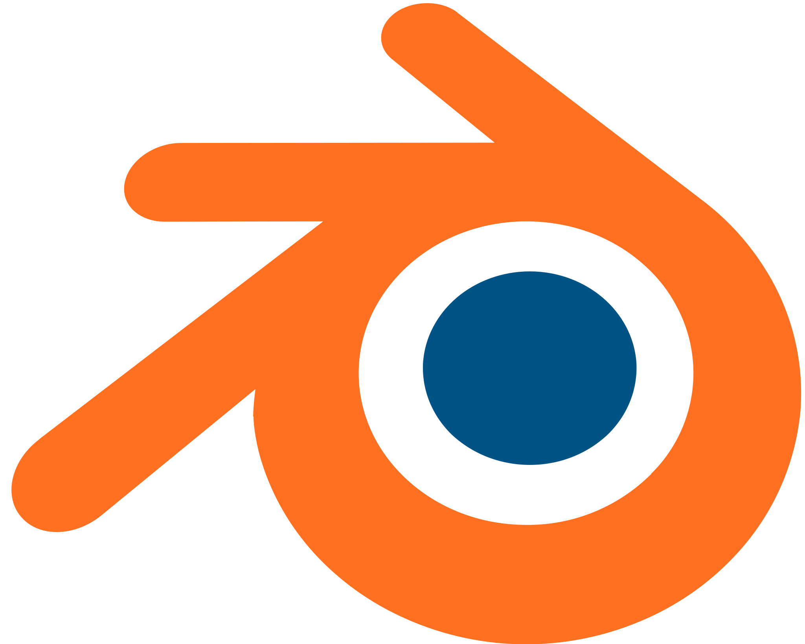
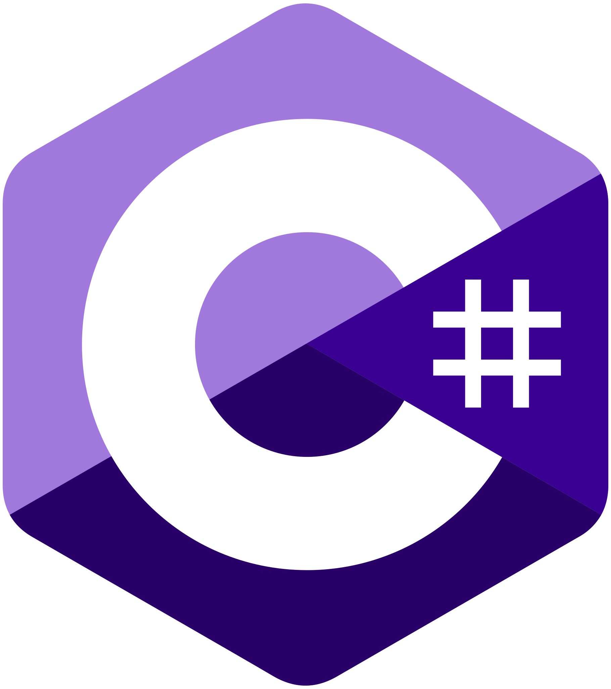
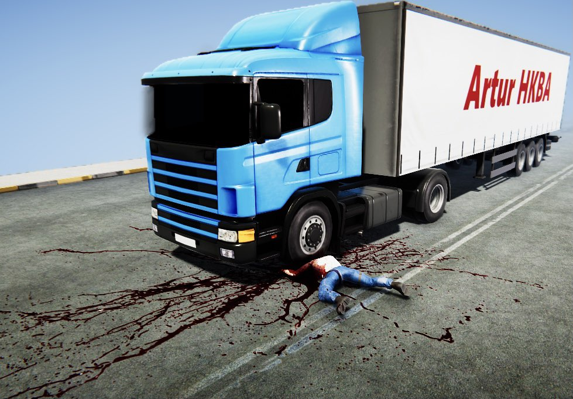
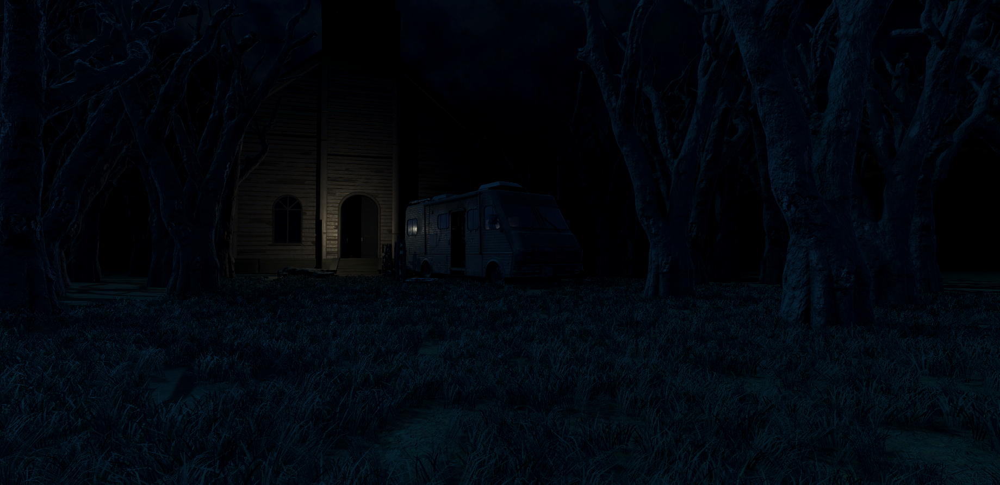
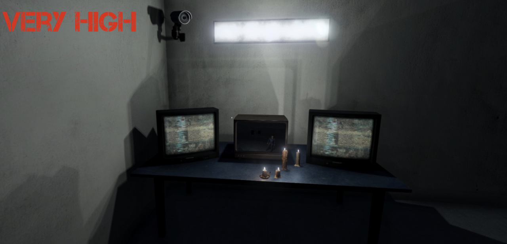
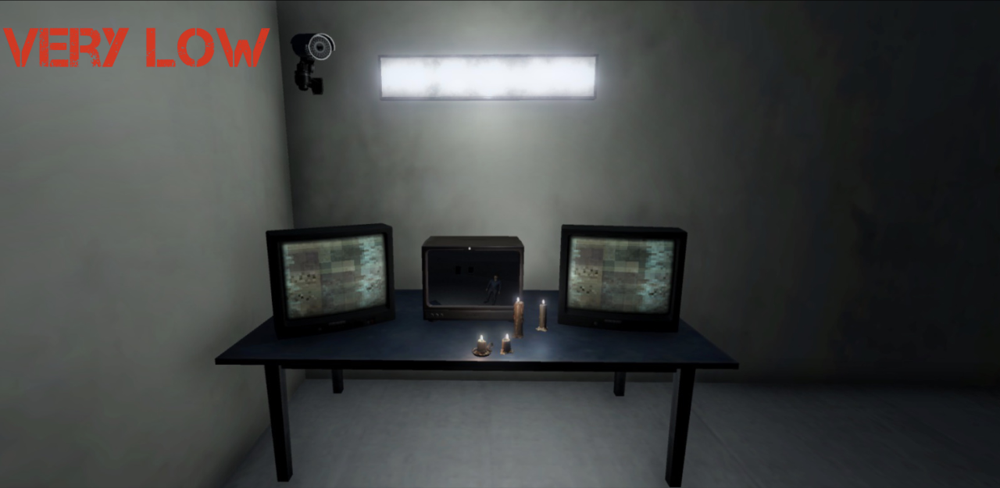
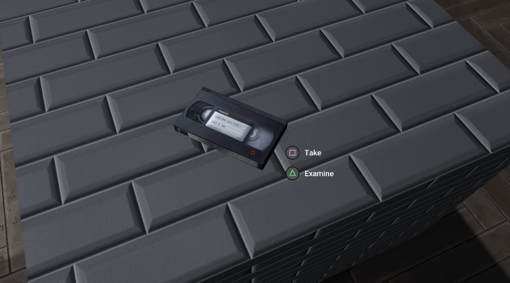

# **2016 – 2019 | Unity Engine: Early Explorations & Prototyping**

**Foundational projects and initial experiments in game development.**

**Tech Stack:**

<div class="badges-container-horizontal" style="display: flex; flex-wrap: wrap; gap: 12px; align-items: center;">

  <span class="skill-badge" style="display: inline-flex; align-items: center; width: max-content; min-width: 180px; padding: 0 12px; height: 45px;">
     
    <a href="https://unity.com" target="_blank" style="text-decoration: none; color: inherit; display: inline-flex; align-items: center; gap: 8px;">
      Unity Engine <span>↗</span>
    </a>
  </span>

  <span class="skill-badge" style="display: inline-flex; align-items: center; width: max-content; min-width: 180px; padding: 0 12px; height: 45px;">
     
    <a href="https://blender.org" target="_blank" style="text-decoration: none; color: inherit; display: inline-flex; align-items: center; gap: 8px;">
      Blender <span>↗</span>
    </a>
  </span>

  <span class="skill-badge" style="display: inline-flex; align-items: center; width: max-content; min-width: 100px; padding: 0 12px; height: 45px; color: inherit;">
     
    C#
  </span>
</div>


!!! info "Overview"
    
    While my journey into game development began in 2014, it was in 2016 that I transitioned into the Unity Engine to bring my concepts to life. During this period, I developed an independent horror project, which served as a foundation for mastering C# scripting, simple enemy AI systems and interactive environment design. The following previews showcase my early work and reflect the beginning of my passion for the creative freedom found in game development, turning complex ideas into playable experiences.


## Simple AI & Pathfinding:


Implemented simple enemy AI utilizing Unity’s NavMesh system and custom waypoint scripting to create dynamic patrol and chase behaviors.

<div class="grid" markdown>
<div markdown>
<span style="display: block; font-size: 1.25em; font-weight: bold; margin-bottom: 0.5em;">Enemy Waypoints</span>
Demonstrating the dynamic patrol routine between the custom waypoint scripts.

<video controls style="width: 100%; border-radius: 8px; background: #000; box-shadow: 0 4px 10px rgba(0,0,0,0.15); margin-top: 0.5em;">
  <source src="../vid/Enemy_waypoints.mp4" type="video/mp4">
  Your browser does not support the video tag.
</video>
</div>

<div markdown>
<span style="display: block; font-size: 1.25em; font-weight: bold; margin-bottom: 0.5em;">NavMesh Preview</span>
Visualizing the underlying Unity NavMesh calculation and pathfinding system in action.

<video controls style="width: 100%; border-radius: 8px; background: #000; box-shadow: 0 4px 10px rgba(0,0,0,0.15); margin-top: 0.5em;">
  <source src="../vid/Navmesh_preview.mp4" type="video/mp4">
  Your browser does not support the video tag.
</video>
</div>
</div>

??? example "Part of SimpleAiPatrol.ss | Navigate to the full [SOURCE CODE](https://github.com/ArturHKBA/ArturHKBA.github.io/tree/main/assets/resources/unity/simpleai)!"

    ``` cs title="SimpleAiPatrol.ss" linenums="7"
    public class SimpleAiPatrol : MonoBehaviour
    {
        private NavMeshAgent agent;
        [SerializeField] private Vector3 firstPosOffset;
        [SerializeField] private Vector3 secondPosOffset;
        public enum AIState { Patrol, Attack, Idle}
        public AIState currentAiState;
        private FieldOfView fieldOfView;
        [SerializeField] private float viewRadius = 15f;
        [Range(0, 360)][SerializeField] private float viewAngle = 15f;
        private bool idleStop = false;
        private bool patrolMove = false;
        [HideInInspector] public bool isAttacking = false;
        private FaceObjectTowardPlayer faceTowardPlayer;
        [SerializeField] private float stopDistanceFromPlayer = 10f;
        private GegnerHealth gegnerHealth;

        void Start()
        {
            gegnerHealth = GetComponent<GegnerHealth>();
            faceTowardPlayer =GetComponentInChildren<FaceObjectTowardPlayer>();
            isAttacking = false;
            fieldOfView = GetComponent<FieldOfView>();
            fieldOfView.viewRadius = viewRadius;    
            fieldOfView.viewAngle = viewAngle;

            firstPosOffset = transform.position + firstPosOffset;
            secondPosOffset = transform.position + secondPosOffset;

            agent = GetComponent<NavMeshAgent>();

        }
        void OnDrawGizmos()
        {
            // Eine Grüne Kugel an der Position der "Transform"

            Gizmos.color = Color.green;
            Gizmos.DrawWireSphere(transform.position, stopDistanceFromPlayer);
        }
        private void LateUpdate()
        {
            switch (currentAiState)
            {
                case AIState.Patrol:
                    Patrol();
                    break;
                case AIState.Attack:
                    Attack();
                    break;
                case AIState.Idle:
                    Idle();
                    break;
            }

            if(gegnerHealth.gegnerGotHit)
            {
                currentAiState = AIState.Attack;
            }
        }
        private void Patrol()
        {
            // Patroliert zwischen Positionen A > B > C > A etc.

            if (!patrolMove)
            {
                // Das Ziel wird gesetzt

                agent.SetDestination(firstPosOffset);
            }
            else
            {
                //Das Ziel wird gesetzt

                agent.SetDestination(secondPosOffset);
            }

            // Das Ziel findet sein Ende

            if (Mathf.Abs(agent.nextPosition.z - firstPosOffset.z) <= 1 && Mathf.Abs(agent.nextPosition.x - firstPosOffset.x) <= 1)
            {
                patrolMove = true;
            }

            if (Mathf.Abs(agent.nextPosition.z - secondPosOffset.z) <= 1 && Mathf.Abs(agent.nextPosition.x - secondPosOffset.x) <= 1)
            {
                patrolMove = false;
            }


            SearchForPlayer();
        }
    ``` 


## Procedural VFX (Particle Systems):

<div class="grid" markdown>
<div style="display: flex; flex-direction: column; justify-content: space-between;" markdown>
<div>
<span style="display: block; font-size: 1.25em; font-weight: bold; margin-bottom: 0.5em;">Dynamic Blood-Splatter</span>
By utilizing collision detection within the Particle System, I ensured that every impact resulted in a unique visual output, avoiding repetitive "canned" animations.
</div>

<video controls style="width: 100%; aspect-ratio: 16/9; object-fit: cover; border-radius: 8px; background: #000; box-shadow: 0 4px 10px rgba(0,0,0,0.15); margin-top: auto; padding-top: 0.5em;">
  <source src="../vid/Blood_particle.mp4" type="video/mp4">
  Your browser does not support the video tag.
</video>
</div>

<div style="display: flex; flex-direction: column; justify-content: space-between;" markdown>
<div>
<span style="display: block; font-size: 1.25em; font-weight: bold; margin-bottom: 0.5em;">Asset Scripting</span>
Another scripted example using some assets to expand the procedural visual effect variety.
</div>

<iframe src="https://www.youtube.com/embed/7seLKmyWc58?si=K120UIK6M6zz_6_e" title="YouTube video player" frameborder="0" allow="accelerometer; autoplay; clipboard-write; encrypted-media; gyroscope; picture-in-picture; web-share" referrerpolicy="strict-origin-when-cross-origin" allowfullscreen style="width: 100%; aspect-ratio: 16/9; border-radius: 8px; box-shadow: 0 4px 10px rgba(0,0,0,0.15); margin-top: auto; padding-top: 0.5em;"></iframe>
</div>

</div>


<div class="grid" style="margin-top: 1.5em;" markdown>

<div style="grid-column: span 2;" markdown>
<span style="display: block; font-size: 1.25em; font-weight: bold; margin-bottom: 0.5em;">Gore Visuals</span>
High-resolution overview and inspectable detail showcase of the compiled custom gore particle sheet.

<div style="position: relative; width: 100%; border-radius: 8px; overflow: hidden; margin-top: 0.5em; box-shadow: 0 4px 10px rgba(0,0,0,0.15);" 
     onclick="this.querySelector('.spoiler-overlay').style.display='none'; this.querySelector('img').style.filter='none'; this.querySelector('a').click();">
  
  <a href="../img/portfolio/Gore.png" class="glightbox" style="display: block;" onclick="event.stopPropagation();">
    
  </a>

  <div class="spoiler-overlay" style="position: absolute; top: 0; left: 0; width: 100%; height: 100%; background: rgba(0,0,0,0.7); display: flex; flex-direction: column; align-items: center; justify-content: center; color: #fff; padding: 20px; text-align: center; cursor: pointer;">
    <span style="font-size: 1.5em; margin-bottom: 8px;">⚠️ <strong>SPOILER: GORE CONTENT</strong></span>
    <span style="font-size: 0.95em; max-width: 450px; opacity: 0.9;">Diese Karte enthält potenziell verstörende Szenen oder explizite Gewaltdarstellungen. Klicke hier, um das Bild direkt zu öffnen.</span>
  </div>

</div>
</div>

</div>


## First-Person Animation:


<div class="grid" markdown>
<div style="grid-column: span 2;" markdown>
I crafted a variety of animations, with a heavy focus on first-person movements. My goal was to move away from robotic motions and create a feel that’s fluid and immersive for the player.

<video controls style="width: 100%; border-radius: 8px; background: #000; box-shadow: 0 4px 10px rgba(0,0,0,0.15); margin-top: 0.5em;">
  <source src="../vid/Reload.mp4" type="video/mp4">
  Your browser does not support the video tag.
</video>
</div>

</div>


## Immersive Gameplay Mechanics (Player States):

<div class="grid" markdown>

<div style="display: flex; flex-direction: column; justify-content: space-between;">
  <div>
    <span style="display: block; font-size: 1.25em; font-weight: bold; margin-bottom: 0.5em;">Shock System</span>
    <p style="margin-bottom: 1em;">I implemented a "Shock System" where entering specific trigger zones changes the player’s physical state (heavy breathing audio and increased camera/aim sway), enhancing psychological horror through mechanical feedback.</p>
  </div>
  <iframe src="https://www.youtube.com/embed/D7W4wC5KI78?si=8_Omy2p7tQU7ztnp" title="YouTube video player" frameborder="0" allow="accelerometer; autoplay; clipboard-write; encrypted-media; gyroscope; picture-in-picture; web-share" referrerpolicy="strict-origin-when-cross-origin" allowfullscreen style="width: 100%; aspect-ratio: 16/9; border-radius: 8px; box-shadow: 0 4px 10px rgba(0,0,0,0.15); margin-top: auto;"></iframe>
</div>

<div style="display: flex; flex-direction: column; justify-content: space-between;">
  <div>
    <span style="display: block; font-size: 1.25em; font-weight: bold; margin-bottom: 0.5em;">Atmospheric Environment</span>
    <p style="margin-bottom: 1em;">Overview of the atmospheric scene design and lighting setup used to construct the trigger zones for the player states.</p>
  </div>
  <a href="../img/portfolio/Scene.png" class="glightbox" style="width: 100%; aspect-ratio: 16/9; display: block; margin-top: auto;">
    
  </a>
</div>

</div>


## Technical Optimization (Graphics Menu):

<div class="grid" markdown>

<div style="grid-column: span 2;" markdown>
Performance optimization is very important, which is why I also worked on a comprehensive settings menu allowing users to toggle graphic settings like Anti-aliasing, Texture quality, Shadow resolution, Shadow distance, Resolution, V-Sync, Anisotropic Filtering and more. This ensured scalability across both high-end and low-end hardware.

<!-- -Slider Container -->
<div style="position: relative; width: 100%; padding-top: 48.828%; border-radius: 8px; overflow: hidden; box-shadow: 0 4px 10px rgba(0,0,0,0.15); margin-top: 1.5em; user-select: none; --slider-pos: 50%;">
  
  
  
  <div style="position: absolute; top: 0; left: 0; width: 100%; height: 100%; clip-path: polygon(0 0, var(--slider-pos) 0, var(--slider-pos) 100%, 0 100%);">
    
    <span style="position: absolute; top: 10px; left: 10px; background: rgba(0,0,0,0.7); color: #fff; padding: 4px 8px; border-radius: 4px; font-size: 0.8em; font-weight: bold; z-index: 2;">VERY LOW</span>
  </div>
  
  <span style="position: absolute; top: 10px; right: 10px; background: rgba(0,0,0,0.7); color: #fff; padding: 4px 8px; border-radius: 4px; font-size: 0.8em; font-weight: bold; z-index: 2;">VERY HIGH</span>

  <div class="slider-line" style="position: absolute; top: 0; bottom: 0; left: var(--slider-pos); width: 3px; background: #fff; pointer-events: none; transform: translateX(-50%); z-index: 3;"></div>

  <input type="range" min="0" max="100" value="50" style="position: absolute; top: 0; left: 0; width: 100%; height: 100%; opacity: 0; cursor: ew-resize; margin: 0; z-index: 4;" 
         oninput="this.parentElement.style.setProperty('--slider-pos', this.value + '%');">
         
</div>
</div>
</div>

??? example "Part of FPSCount.ss | Navigate to the full [SOURCE CODE](https://github.com/ArturHKBA/ArturHKBA.github.io)!"

    ``` cs title="FPSCount.cs" linenums="41"
    private void OnApplicationQuit()
      {
        if (totalUpdates > 1)
        {
          int final = totalFps / (totalUpdates - 1);
          Debug.Log("Deine FPS:"" = " + final);
        }
      }
    }    
    ```


## Cross-Platform Input Support:


<div class="grid" markdown>
<div style="grid-column: span 2;" markdown>
I built a flexible input system with full support for Xbox and DualShock controllers. My goal was to make sure playing on a PC feels just as smooth and responsive as playing on a console.

<a href="../img/portfolio/Gamepad.png" class="glightbox" style="display: block; margin-top: 1em;">
  
</a>

<div style="margin-top: 1em; font-size: 0.9em; display: inline-flex; align-items: center; gap: 8px;">
  <span style="font-weight: bold; color: var(--md-typeset-color, #fff);">Source Code:</span>
  <span style="background: rgba(239, 68, 68, 0.15); color: #ef4444; padding: 2px 8px; border-radius: 4px; font-weight: bold; font-size: 0.85em; border: 1px solid rgba(239, 68, 68, 0.3);">COMING SOON</span>
</div>

</div>

</div>

!!! warning "Note"
    
    Beyond these highlights, I have built dozens of smaller projects to sharpen my skills. While I was constantly iterating on playable builds for my horror title, the milestones below represent my biggest technical leaps and the core of my growth as a developer.

<br/><br/>


