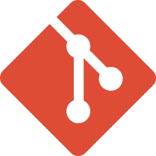
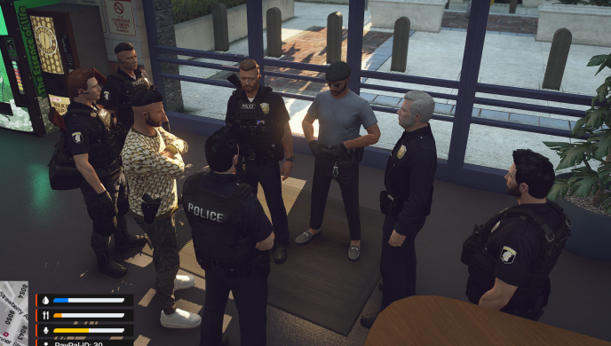
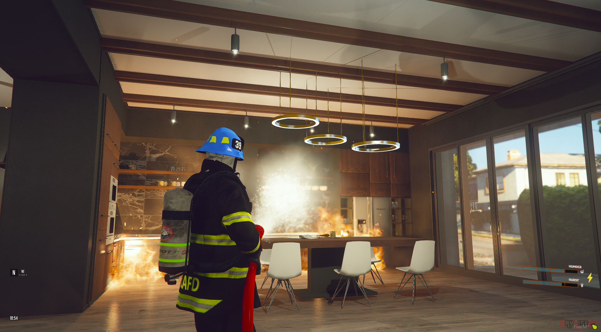
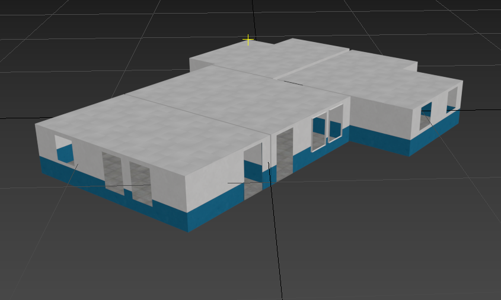
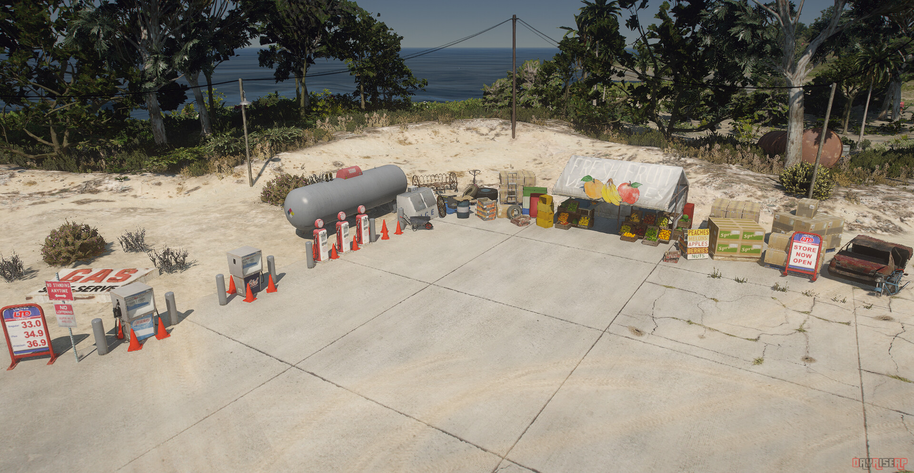
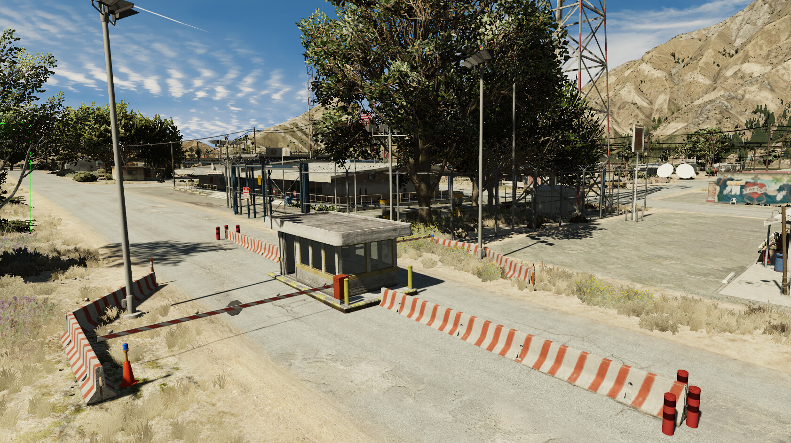
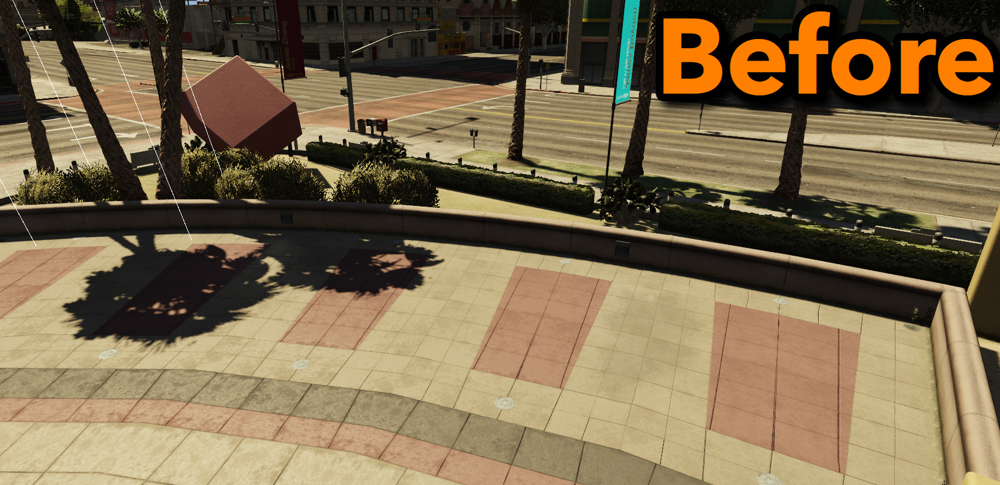
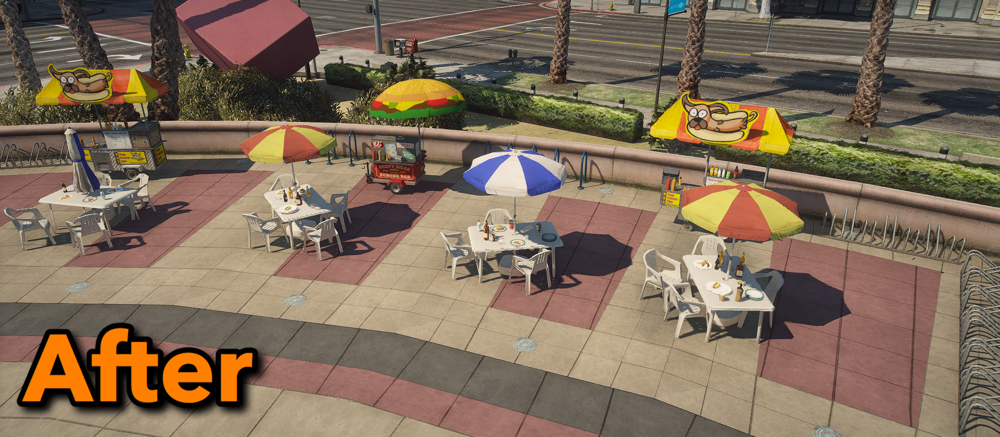

# **2019 – 2021 | Modding Frameworks: Grand Theft Auto V (FiveM)**

**Development of custom systems and multiplayer frameworks.**

**Tech Stack:**

<div class="badges-container-horizontal" style="display: flex; flex-wrap: wrap; gap: 12px; align-items: center;">

  <span class="skill-badge" style="display: inline-flex; align-items: center; width: max-content; min-width: 180px; padding: 0 12px; height: 45px;">
     
    <a href="https://www.autodesk.com/products/3ds-max/overview" target="_blank" style="text-decoration: none; color: inherit; display: inline-flex; align-items: center; gap: 8px;">
      3ds Max <span>↗</span>
    </a>
  </span>

  <span class="skill-badge" style="display: inline-flex; align-items: center; width: max-content; min-width: 180px; padding: 0 12px; height: 45px;">
     
    <a href="https://www.zmodeler3.com/" target="_blank" style="text-decoration: none; color: inherit; display: inline-flex; align-items: center; gap: 8px;">
      ZModeler <span>↗</span>
    </a>
  </span>

  <span class="skill-badge" style="display: inline-flex; align-items: center; width: max-content; min-width: 180px; padding: 0 12px; height: 45px;">
     
    <a href="https://www.adobe.com/products/photoshop.html" target="_blank" style="text-decoration: none; color: inherit; display: inline-flex; align-items: center; gap: 8px;">
      Adobe Photoshop <span>↗</span>
    </a>
  </span>

  <span class="skill-badge" style="display: inline-flex; align-items: center; width: max-content; min-width: 180px; padding: 0 12px; height: 45px;">
     
    <a href="https://mui.com/material-ui/" target="_blank" style="text-decoration: none; color: inherit; display: inline-flex; align-items: center; gap: 8px;">
      Material UI <span>↗</span>
    </a>
  </span>

  <span class="skill-badge" style="display: inline-flex; align-items: center; width: max-content; min-width: 180px; padding: 0 12px; height: 45px;">
     
    <a href="https://github.com/" target="_blank" style="text-decoration: none; color: inherit; display: inline-flex; align-items: center; gap: 8px;">
      GitHub <span>↗</span>
    </a>
  </span>

  <span class="skill-badge" style="display: inline-flex; align-items: center; width: max-content; min-width: 100px; padding: 0 12px; height: 45px;">
     
    <a href="https://git-scm.com/" target="_blank" style="text-decoration: none; color: inherit; display: inline-flex; align-items: center; gap: 8px;">
      Git <span>↗</span>
    </a>
  </span>

  <span class="skill-badge" style="display: inline-flex; align-items: center; width: max-content; min-width: 100px; padding: 0 12px; height: 45px; color: inherit;">
     
    HTML
  </span>

  <span class="skill-badge" style="display: inline-flex; align-items: center; width: max-content; min-width: 100px; padding: 0 12px; height: 45px; color: inherit;">
     
    CSS
  </span>

  <span class="skill-badge" style="display: inline-flex; align-items: center; width: max-content; min-width: 100px; padding: 0 12px; height: 45px; color: inherit;">
     
    Lua
  </span>
</div>


!!! info "Overview"
    
    End of 2019 I started building complex, large-scale systems for my community. I dedicated over 1,500 hours to developing immersive gameplay mechanics and managing persistent worlds for a live player base.

    **My key Contributions:**

    * **Systems programming:** Developed core gameplay features using Lua to enhance player immersion and interaction.
    * **Database management:** Designed and maintained a robust SQL infrastructure to handle player data, inventory systems and dynamic housing.
    * **World building:** Utilized CodeWalker and OpenIV to modify yMap files for game environments.
    * **Custom assets:** Brought unique visuals to the game by creating and optimizing 3D models in Blender and ZModeler.

    <a href="../img/portfolio/LSPD.png" class="glightbox" style="display: block; margin-top: 1.5em;">
      
    </a>


## Realistic Inventory & Weapon Restriction

!!! danger no-icon ":material-pistol: Tactical Loadout & Weight Enforcement"

    * **The problem:** The "infinite pocket" system in the vanilla game broke immersion and created unfair combat advantages.
    * **The solution:** Developed a custom Lua script to limit player loadouts to a realistic configuration (e.g., two sidearms and one primary long weapon).
    * **Impact:** Forced strategic gameplay by requiring players to use vehicle trunks or armories/bags to switch heavy gear. Notably, this mechanic was later revealed as a core feature for the upcoming Grand Theft Auto VI.

    <div class="media-wrapper">
      <iframe src="https://www.youtube.com/embed/kvhgb0Rjm2Q?si=RTPUdai43mQmfDJB" allowfullscreen></iframe>
    </div>

    ??? example ":material-code-braces: View Script Snippet (`client.lua`) :material-github: [Full Source Code on GitHub](https://github.com/ArturHKBA/ArturHKBA.github.io/tree/main/assets/resources/modding/script_waffensystem)"

        ```lua title="client.lua" linenums="41"
        private void OnApplicationQuit()
        {
            if (totalUpdates > 1)
            {
                int final = totalFps / (totalUpdates - 1);
                Debug.Log("Deine FPS: " + final);
            }
        }
        ```

## Emergency Lighting System Overhaul

!!! danger no-icon ":material-car-emergency: Multi-State Siren & Lightbar Controller"

    * **The goal:** I wanted to give Roleplay enthusiasts a much more immersive, high-fidelity experience with emergency vehicles.
    * **How it works:** I moved away from the basic "on/off" vanilla toggle and built a multi-state system. This gives players manual control over specific siren tones, patterns, and flash speeds.
    * **The result:** It completely changed how emergency ops feel. While the custom GUI was still in development, the depth of the siren system added a huge layer of realism.

    <div class="media-wrapper">
      <iframe src="https://www.youtube.com/embed/KwA9SP9If0I?si=xLbumc2ITB9jDBD0" allowfullscreen></iframe>
    </div>

    ??? example ":material-code-braces: View Script Snippet (`client.lua`) :material-github: [Full Source Code on GitHub](https://github.com/ArturHKBA/ArturHKBA.github.io/tree/main/assets/resources/modding/script_lichtsystem)"

        ```lua title="client.lua" linenums="41"
        private void OnApplicationQuit()
        {
            if (totalUpdates > 1)
            {
                int final = totalFps / (totalUpdates - 1);
                Debug.Log("Deine FPS: " + final);
            }
        }
        ```


## Dynamic Fire/Flame System

!!! danger no-icon ":material-fire: Procedural Fire Events & Firefighter Simulation"

    * **The impact:** This project really took off, hitting over 50,000 views and reaching way beyond my usual community.
    * **The tech:** I built a randomized event system that triggers fires at specific coordinates, keeping the gameplay unpredictable and fresh.
    * **The innovation:** When this dropped, it was one of the first systems of its kind, helping shift the standard for how job-based scripts work in FiveM.

    === ":material-video: Gameplay Showcase"

        <div class="media-wrapper">
          <iframe src="https://www.youtube.com/embed/GuhfZzz1I4o?si=KHKWWXQQJaYcqhFD" allowfullscreen></iframe>
        </div>

    === ":material-image-outline: Simulation Scene"

        <div class="media-wrapper">
          <a href="../img/portfolio/Hose.png" class="glightbox" style="display: block; width: 100%; height: 100%;">
            
          </a>
        </div>

    ??? example ":material-code-braces: View Script Snippet (`client.lua`) :material-github: [Full Source Code on GitHub](https://github.com/ArturHKBA/ArturHKBA.github.io/tree/main/assets/resources/modding/script_feuer)"

        ```lua title="client.lua" linenums="41"
        private void OnApplicationQuit()
        {
            if (totalUpdates > 1)
            {
                int final = totalFps / (totalUpdates - 1);
                Debug.Log("Deine FPS: " + final);
            }
        }
        ```

## Mask Shop System

!!! danger no-icon ":material-drama-masks: State-Machine Driven Character Customization"

    * **Challenge & Community:** Implementing the most-requested feature to allow players to customize appearances and hide their identities initially caused severe desync and invincibility bugs.
    * **Technical fix:** Resolved these complex state machine issues by developing a custom "Menu State" for smoother interactions.
    * **Code Quality & Stability:** Managed player health and movement flags (frozen states) to ensure the game remains fully stable during character customization *(refer to <code>client.lua</code> lines 150–166 in the repository for implementation details)*.

    <div class="media-wrapper">
      <iframe src="https://www.youtube.com/embed/MJYCk7PjWg0?si=pXETnlpDfg8l3yJM" allowfullscreen></iframe>
    </div>

    ??? example ":material-code-braces: View Script Snippet (`client.lua`) :material-github: [Full Source Code on GitHub](https://github.com/ArturHKBA/ArturHKBA.github.io/tree/main/assets/resources/modding/script_masken)"

        ```lua title="client.lua" linenums="41"
        private void OnApplicationQuit()
        {
            if (totalUpdates > 1)
            {
                int final = totalFps / (totalUpdates - 1);
                Debug.Log("Deine FPS: " + final);
            }
        }
        ```

## Immersive Armory & Animation Syncing

!!! danger no-icon ":material-shield-sword-outline: Tactile World-Space Weapon & Animation Sync"

    * **Philosophy:** Moving away from "press button to receive item" prompts in favor of tactile, visual interactions.
    * **Technical Execution:** Spent extensive time syncing character animations with precise world coordinates for weapon props.
    * **Outcome:** A highly polished, physical armory system that reinforces player immersion through visual feedback and realistic timing.

    <div class="media-wrapper">
      <iframe src="https://www.youtube.com/embed/6d4M4rus-UE?si=_2jo7eIRxtx-JhyS" allowfullscreen></iframe>
    </div>

    ??? example ":material-code-braces: View Script Snippet (`client.lua`) :material-github: [Full Source Code on GitHub](https://github.com/ArturHKBA/ArturHKBA.github.io/tree/main/assets/resources/modding/script_polizeilager)"

        ```lua title="client.lua" linenums="41"
        private void OnApplicationQuit()
        {
            if (totalUpdates > 1)
            {
                int final = totalFps / (totalUpdates - 1);
                Debug.Log("Deine FPS: " + final);
            }
        }
        ```


<br/><br/>


## Other projects & world building:

!!! info "Community Contributions & Open Source"

    <div style="display: flex; gap: 32px; align-items: center; justify-content: space-between; flex-wrap: wrap; margin-top: 12px;">
      
      <div style="flex: 1 1 350px; min-width: 300px; line-height: 1.7; font-size: 1.05em;" markdown>
      Beyond my main systems, I love giving back to the modding scene. I have released several free scripts and mapping projects to help other server owners level up their realism. 
      <br><br>
      For me, it’s always been about blending technical polish with solid environmental storytelling.
      </div>
      
      <div style="flex: 1 1 350px; max-width: 400px;">
        <a href="../img/portfolio/WIP.png" class="glightbox" style="display: block; width: 100%;">
          
        </a>
      </div>
      
    </div>


## Custom Mapping & Level Design:

<div style="display: grid; grid-template-columns: repeat(auto-fit, minmax(300px, 1fr)); gap: 24px; margin-top: 1em;">

  <div style="background: var(--md-code-bg-color, #1e1e24); border: 1px solid rgba(255,255,255,0.05); border-radius: 8px; padding: 20px; display: flex; flex-direction: column; justify-content: space-between; box-shadow: 0 4px 10px rgba(0,0,0,0.2);">
    <div>
      <span style="display: block; font-size: 1.2em; font-weight: bold; margin-bottom: 12px; color: var(--md-typeset-a-color, #2196f3);">LSIA Border Checkpoint</span>
      <b>The project:</b> I built a detailed border crossing near the airport to create more immersive roleplay opportunities. 
      <br><br>
      <b>Community:</b> To help other server owners, I released the full source files on public forums for anyone to use.
    </div>
    <div style="margin-top: 20px;">
      <iframe src="https://www.youtube.com/embed/MY1Vn3XYUdE?si=tmkhnlPU1iY4vayK" title="LSIA Border Map Showcase" frameborder="0" allow="accelerometer; autoplay; clipboard-write; encrypted-media; gyroscope; picture-in-picture" sandbox="allow-scripts allow-same-origin allow-popups allow-presentation" style="width: 100%; aspect-ratio: 16/9; border-radius: 6px; margin-bottom: 16px; display: block;"></iframe>
      <a href="https://forum.cfx.re/t/release-ymap-fivem-lsia-border-map-with-detailed-objects-interiors-dynamic-objects/1570768" target="_blank" class="md-button md-button--primary" style="display: block; text-align: center; width: 100%;">View Cfx Release</a>
    </div>
  </div>

  <div style="background: var(--md-code-bg-color, #1e1e24); border: 1px solid rgba(255,255,255,0.05); border-radius: 8px; padding: 20px; display: flex; flex-direction: column; justify-content: space-between; box-shadow: 0 4px 10px rgba(0,0,0,0.2);">
    <div>
      <span style="display: block; font-size: 1.2em; font-weight: bold; margin-bottom: 12px; color: var(--md-typeset-a-color, #2196f3);">Cayo Perico Infrastructure</span>
      <b>The change:</b> To fix a major gameplay oversight in the original Rockstar update, I built and integrated a fully functional gas station on the island.
      <br><br>
      <b>The depth:</b> I didn't just place a pump. I added a detailed shop section, custom props and ambient NPC scenarios to make the area feel natural.
    </div>
    <div style="margin-top: 20px;">
      <a href="../img/portfolio/Forum_Cayo_Perico.png" class="glightbox" style="display: block; margin-bottom: 16px;">
        
      </a>
      <a href="https://forum.cfx.re/t/release-cayo-perico-gas-pump-detailed-ymap-with-a-little-shop-dynamic-objects/1906934" target="_blank" class="md-button md-button--primary" style="display: block; text-align: center; width: 100%;">View Cfx Release</a>
    </div>
  </div>

  <div style="background: var(--md-code-bg-color, #1e1e24); border: 1px solid rgba(255,255,255,0.05); border-radius: 8px; padding: 20px; display: flex; flex-direction: column; justify-content: space-between; box-shadow: 0 4px 10px rgba(0,0,0,0.2);">
    <div>
      <span style="display: block; font-size: 1.2em; font-weight: bold; margin-bottom: 12px; color: var(--md-typeset-a-color, #2196f3);">Sandy Shores Sheriff Exterior</span>
      <b>The focus:</b> I focus on small-scale environmental polish to bridge the gap between a static map and a living world.
      <br><br>
      <b>The goal:</b> By refining those tiny interactions, I make sure every corner of a scene feels like it has a purpose.
    </div>
    <div style="margin-top: 20px;">
      <a href="../img/portfolio/Forum_Border.png" class="glightbox" style="display: block; margin-bottom: 16px;">
        
      </a>
      <a href="https://forum.cfx.re/t/sandy-shores-sheriff-exterior-map/1874666" target="_blank" class="md-button md-button--primary" style="display: block; text-align: center; width: 100%;">View Cfx Release</a>
    </div>
  </div>

</div>

<div style="background: var(--md-code-bg-color, #1e1e24); border: 1px solid rgba(255,255,255,0.05); border-radius: 12px; padding: 24px; margin-top: 24px; box-shadow: 0 10px 30px rgba(0,0,0,0.25);">
  <div class="grid" style="grid-template-columns: 1.2fr 1fr; gap: 32px; align-items: center;" markdown>
  
  <div>
    <span style="display: block; font-size: 1.5em; font-weight: bold; margin-bottom: 16px; color: var(--md-typeset-a-color, #2196f3); letter-spacing: -0.3px;">Legion Square Upgrade</span>
    <p style="margin-bottom: 16px; line-height: 1.6;"><b>The upgrade:</b> An outdoor objects overhaul bringing a dynamic Hotdog and Burger stand setup directly to the center of Los Santos.</p>
    <p style="margin-bottom: 24px; line-height: 1.6;"><b>The design:</b> Focused heavily on high-fidelity prop placements and cozy sitting arrangements to transform a sterile concrete square into a vibrant community gathering zone.</p>
    <a href="https://forum.cfx.re/t/release-map-fivem-legion-square-hotdog-burger-stand-outdoor-objects-upgrade/1468741" target="_blank" class="md-button md-button--primary" style="display: inline-block; text-align: center; min-width: 200px; border-radius: 6px; font-weight: bold;">View Cfx Release</a>
  </div>
  
  <div>
    <div style="position: relative; width: 100%; border-radius: 8px; overflow: hidden; box-shadow: 0 8px 24px rgba(0,0,0,0.2); user-select: none; --slider-pos: 50%;">
      
      
      
      <div style="position: absolute; top: 0; left: 0; width: 100%; height: 100%; clip-path: polygon(0 0, var(--slider-pos) 0, var(--slider-pos) 100%, 0 100%);">
        
      </div>
      
      <div style="position: absolute; top: 0; bottom: 0; left: var(--slider-pos); width: 2px; background: rgba(255,255,255,0.9); pointer-events: none; transform: translateX(-50%); z-index: 3; box-shadow: 0 0 8px rgba(0,0,0,0.5);"></div>

      <input type="range" min="0" max="100" value="50" style="position: absolute; top: 0; left: 0; width: 100%; height: 100%; opacity: 0; cursor: ew-resize; margin: 0; z-index: 4;" 
             oninput="this.parentElement.style.setProperty('--slider-pos', this.value + '%');">
             
    </div>
  </div>
  
  </div>
</div>


<br>

!!! danger no-icon ":material-github: GitHub Repository"

    Check out more of my unlisted projects directly on [GitHub](https://github.co)


!!! warning "Note"
    
      These highlights are just a small selection of the systems and environments I have developed over the past few years. If you are interested in a deeper technical breakdown or would like to see more of my work in action, feel free to visit my forum, check out my showcases on YouTube or contact me directly. I’m always open to discussing technical solutions and new projects.

<br/><br/>