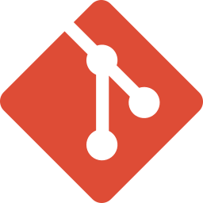
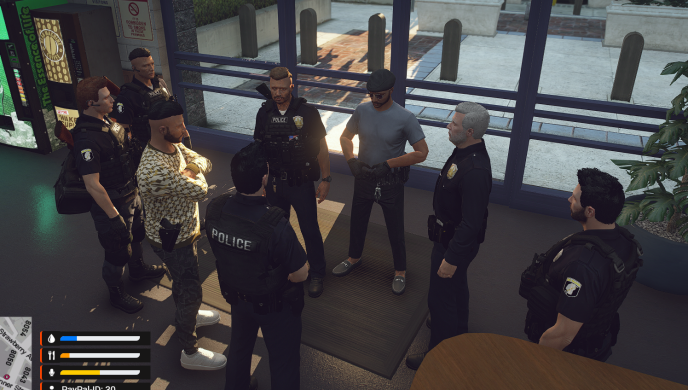
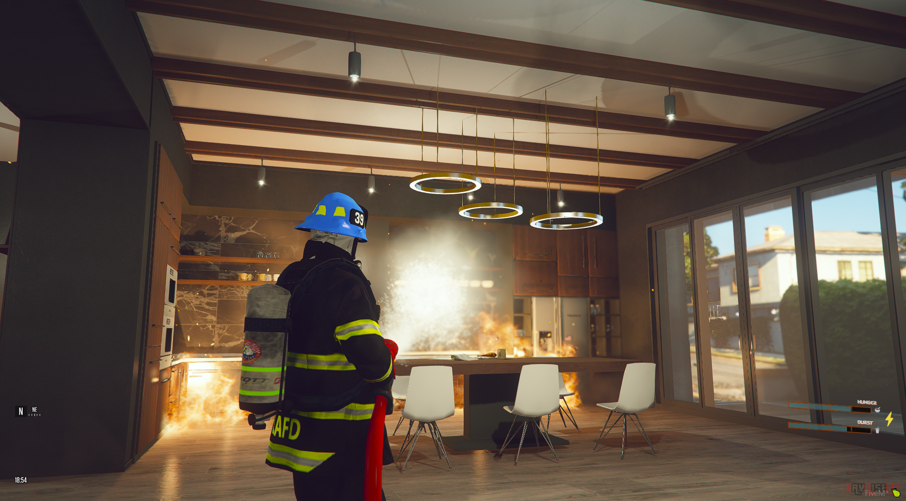
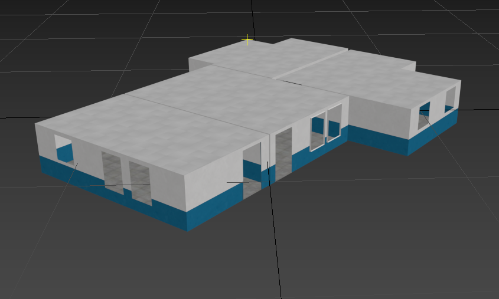
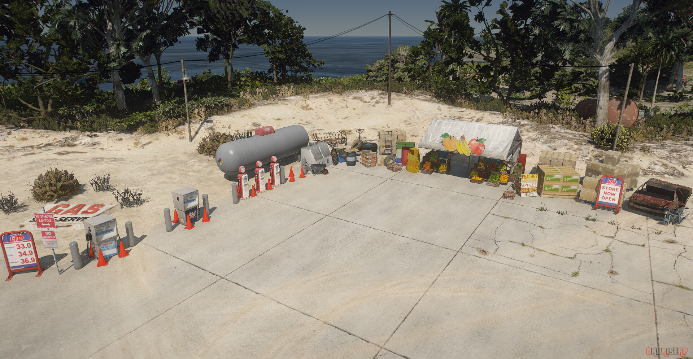
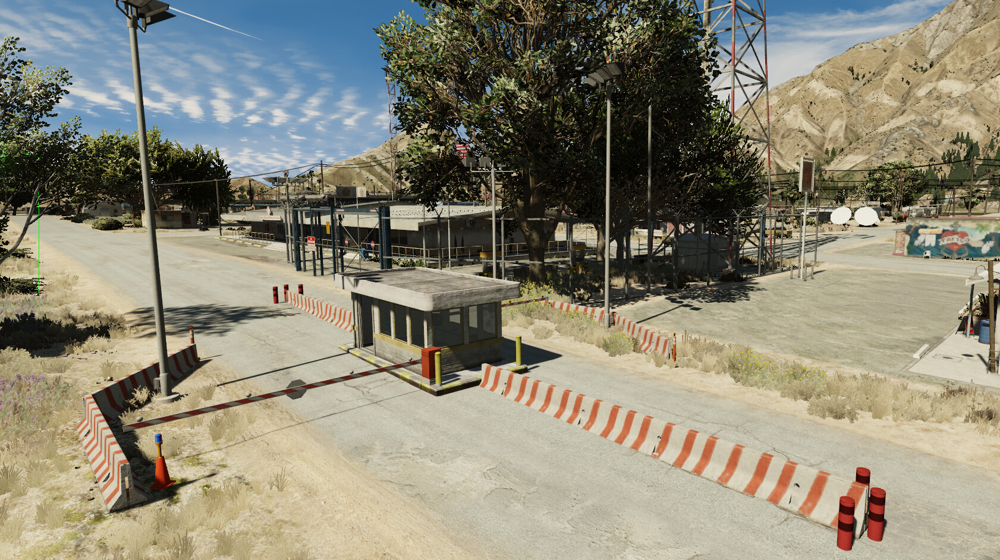
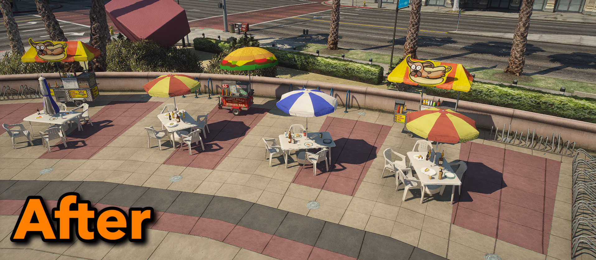

# **2019 – 2021 | Modding Frameworks: Grand Theft Auto V (FiveM)**

**Development of custom systems and multiplayer frameworks.**

**Tech Stack:**

<div class="badges-container-horizontal" style="display: flex; flex-wrap: wrap; gap: 12px; align-items: center;">

  <span class="skill-badge" style="display: inline-flex; align-items: center; width: max-content; min-width: 180px; padding: 0 12px; height: 45px;">
     
    <a href="https://www.autodesk.com/products/3ds-max/overview" target="_blank" style="text-decoration: none; color: inherit; display: inline-flex; align-items: center; gap: 8px;">
      3ds Max <span>↗</span>
    </a>
  </span>

  <span class="skill-badge" style="display: inline-flex; align-items: center; width: max-content; min-width: 180px; padding: 0 12px; height: 45px;">
     
    <a href="https://www.zmodeler3.com/" target="_blank" style="text-decoration: none; color: inherit; display: inline-flex; align-items: center; gap: 8px;">
      ZModeler <span>↗</span>
    </a>
  </span>

  <span class="skill-badge" style="display: inline-flex; align-items: center; width: max-content; min-width: 180px; padding: 0 12px; height: 45px;">
     
    <a href="https://www.adobe.com/products/photoshop.html" target="_blank" style="text-decoration: none; color: inherit; display: inline-flex; align-items: center; gap: 8px;">
      Adobe Photoshop <span>↗</span>
    </a>
  </span>

  <span class="skill-badge" style="display: inline-flex; align-items: center; width: max-content; min-width: 180px; padding: 0 12px; height: 45px;">
     
    <a href="https://mui.com/material-ui/" target="_blank" style="text-decoration: none; color: inherit; display: inline-flex; align-items: center; gap: 8px;">
      Material UI <span>↗</span>
    </a>
  </span>

  <span class="skill-badge" style="display: inline-flex; align-items: center; width: max-content; min-width: 180px; padding: 0 12px; height: 45px;">
     
    <a href="https://github.com/" target="_blank" style="text-decoration: none; color: inherit; display: inline-flex; align-items: center; gap: 8px;">
      GitHub <span>↗</span>
    </a>
  </span>

  <span class="skill-badge" style="display: inline-flex; align-items: center; width: max-content; min-width: 100px; padding: 0 12px; height: 45px;">
     
    <a href="https://git-scm.com/" target="_blank" style="text-decoration: none; color: inherit; display: inline-flex; align-items: center; gap: 8px;">
      Git <span>↗</span>
    </a>
  </span>

  <span class="skill-badge" style="display: inline-flex; align-items: center; width: max-content; min-width: 100px; padding: 0 12px; height: 45px; color: inherit;">
     
    HTML
  </span>

  <span class="skill-badge" style="display: inline-flex; align-items: center; width: max-content; min-width: 100px; padding: 0 12px; height: 45px; color: inherit;">
     
    CSS
  </span>

  <span class="skill-badge" style="display: inline-flex; align-items: center; width: max-content; min-width: 100px; padding: 0 12px; height: 45px; color: inherit;">
     
    Lua
  </span>
</div>


!!! info "Overview"
    
    End of 2019 I started building complex, large-scale systems for my community. I dedicated over 1,500 hours to developing immersive gameplay mechanics and managing persistent worlds for a live player base.

    **My key Contributions:**

    * **Systems programming:** Developed core gameplay features using Lua to enhance player immersion and interaction.
    * **Database management:** Designed and maintained a robust SQL infrastructure to handle player data, inventory systems and dynamic housing.
    * **World building:** Utilized CodeWalker and OpenIV to modify yMap files for game environments.
    * **Custom assets:** Brought unique visuals to the game by creating and optimizing 3D models in Blender and ZModeler.

    <a href="../img/portfolio/LSPD.png" class="glightbox" style="display: block; margin-top: 1.5em;">
      
    </a>


## Realistic Inventory & Weapon Restriction:

<div class="grid" markdown>

<div style="display: flex; flex-direction: column; justify-content: center;" markdown>

* **The problem:** The "infinite pocket" system in the vanilla game broke immersion and created unfair combat advantages.
* **The solution:** Developed a custom Lua script to limit player loadouts to a realistic configuration (e.g. two sidearms and one primary long weapon).
* **Impact:** Forced strategic gameplay by requiring players to use vehicle trunks or armories/bags to switch heavy gear. Notably, this mechanic was later revealed as a core feature for the upcoming Grand Theft Auto VI.

</div>

<div style="display: flex; align-items: center; justify-content: center;" markdown>
<iframe src="https://www.youtube.com/embed/kvhgb0Rjm2Q?si=RTPUdai43mQmfDJB" title="YouTube video player" frameborder="0" allow="accelerometer; autoplay; clipboard-write; encrypted-media; gyroscope; picture-in-picture; web-share" referrerpolicy="strict-origin-when-cross-origin" allowfullscreen style="width: 100%; aspect-ratio: 16/9; border-radius: 8px; box-shadow: 0 4px 10px rgba(0,0,0,0.15);"></iframe>
</div>

</div>

??? example "Part of client.lua | Navigate to the full [SOURCE CODE](https://github.com/ArturHKBA/ArturHKBA.github.io/tree/main/assets/resources/modding/script_waffensystem)!"

    ``` lua title="client.lua" linenums="200"
    function drawWeaponLarge(ped, newWeapon)
	if has_weapon_on_hinten and newWeapon == weaponL then
		drawWeaponOnhinten()
		has_weapon_on_hinten = false
		return
	end

	local door = isNearDoor()
	if PlayerData.job.name == 'police' and (door == 'driver' or door == 'passenger') then
		blocked = true
		local coordA = GetEntityCoords(ped, 1)
		local coordB = GetOffsetFromEntityInWorldCoords(ped, 0.0, 2.0, 0.0)
		local vehicle = getVehicleInDirection(coordA, coordB)
		if DoesEntityExist(vehicle) and IsEntityAVehicle(vehicle) then
			if door == 'driver' then
				SetVehicleDoorOpen(vehicle, 0, false, false)
			elseif door == 'passenger' then
				SetVehicleDoorOpen(vehicle, 1, false, false)
			end
		end
		removeWeaponOnhinten()
		startAnim("mini@repair", "fixing_a_ped")
		SetCurrentPedWeapon(ped, newWeapon, true)
		blocked = false
		if DoesEntityExist(vehicle) and IsEntityAVehicle(vehicle) then
			if door == 'driver' then
				SetVehicleDoorShut(vehicle, 0, false, false)
			elseif door == 'passenger' then
				SetVehicleDoorShut(vehicle, 1, false, false)
			end
		end
		weaponL = newWeapon
		hasWeaponL = true
	elseif not isNearTrunk() then
		SetCurrentPedWeapon(ped, GetHashKey("WEAPON_UNARMED"), true)
		qb.ShowNotification('Du trägst keine Langwaffe bei dir')
	else
		blocked = true
		removeWeaponOnhinten()
		startAnim("mini@repair", "fixing_a_ped")
		blocked = false
		local coordA = GetEntityCoords(ped, 1)
		local coordB = GetOffsetFromEntityInWorldCoords(ped, 0.0, 2.0, 0.0)
		local vehicle = getVehicleInDirection(coordA, coordB)
		if DoesEntityExist(vehicle) and IsEntityAVehicle(vehicle) then
			SetVehicleDoorShut(vehicle, 5, false, false)
		end
		weaponL = newWeapon
		hasWeaponL = true
	end
    ```


## Emergency lighting system Overhaul:


<div class="grid" markdown>

<div style="display: flex; flex-direction: column; justify-content: center;" markdown>

* **The goal:** I wanted to give Roleplay enthusiasts a much more immersive, high-fidelity experience with emergency vehicles.
* **How it works:** I moved away from the basic "on/off" vanilla toggle and built a multi-state system. This gives players manual control over specific siren tones, patterns and flash speeds. 
* **The result:** It completely changed how emergency ops feel. While the custom GUI was still in development, the depth of the siren system added a huge layer of realism.

</div>

<div style="display: flex; align-items: center; justify-content: center;" markdown>
<iframe src="https://www.youtube.com/embed/KwA9SP9If0I?si=xLbumc2ITB9jDBD0" title="Dayrise Hardcore RolePlay [EMERGENCY System]" frameborder="0" allow="accelerometer; autoplay; clipboard-write; encrypted-media; gyroscope; picture-in-picture; web-share" referrerpolicy="strict-origin-when-cross-origin" allowfullscreen style="width: 100%; aspect-ratio: 16/9; border-radius: 8px; box-shadow: 0 4px 10px rgba(0,0,0,0.15);"></iframe>
</div>

</div>

??? example "Part of client.lua | Navigate to the full [SOURCE CODE](https://github.com/ArturHKBA/ArturHKBA.github.io/tree/main/assets/resources/modding/script_lichtsystem)!"

    ``` lua title="client.lua" linenums="200" ```


## Dynamic fire/flame System:

<div class="grid" style="grid-template-columns: 1fr 1fr; gap: 16px; margin-bottom: 12px;" markdown>
<div>
<span style="display: block; font-size: 1.25em; font-weight: bold; margin-bottom: 0.5em;">Project Impact & Tech</span>
<b>The impact:</b> This project really took off, hitting over 50.000 views and reaching way beyond my usual community.
<br><br>
<b>The tech:</b> I built a randomized event system that triggers fires at specific coordinates, keeping the gameplay unpredictable and fresh.
</div>

<div>
<span style="display: block; font-size: 1.25em; font-weight: bold; margin-bottom: 0.5em;">In-Game Innovation</span>
<b>The innovation:</b> When this dropped, it was one of the first systems of its kind, helping shift the standard for how job-based scripts work in FiveM.
</div>
</div>

<div class="grid" style="grid-template-columns: 1fr 1fr; gap: 16px; align-items: start;" markdown>
<div style="width: 100%; aspect-ratio: 16/9;">
  <iframe src="https://www.youtube.com/embed/GuhfZzz1I4o?si=KHKWWXQQJaYcqhFD" title="YouTube video player" frameborder="0" allow="accelerometer; autoplay; clipboard-write; encrypted-media; gyroscope; picture-in-picture; web-share" sandbox="allow-scripts allow-same-origin allow-popups allow-presentation" style="width: 100%; height: 100%; border-radius: 8px; box-shadow: 0 4px 10px rgba(0,0,0,0.15);"></iframe>
</div>

<div style="width: 100%; aspect-ratio: 16/9;">
  <a href="../img/portfolio/Hose.png" class="glightbox" style="display: block; width: 100%; height: 100%;">
    
  </a>
</div>
</div>

??? example "Part of client.lua | Navigate to the full [SOURCE CODE](https://github.com/ArturHKBA/ArturHKBA.github.io/tree/main/assets/resources/modding/script_feuer)!"

    ``` lua title="client.lua" linenums="200" ```


## Mask Shop System:


<div class="grid" markdown>

<div style="display: flex; flex-direction: column; justify-content: center;" markdown>

* **Challenge & Community:** Implementing the most-requested feature to allow players to customize appearances and hide their identities initially caused severe desync and invincibility bugs.
* **Technical fix:** Resolved these complex state machine issues by developing a custom "Menu State" for smoother interactions.
* **Code Quality & Stability:** Managed player health and movement flags (frozen states) to ensure the game remains fully stable during character customization. *(Refer to client.lua lines 150-166 in the repository for implementation details).*

</div>

<div style="display: flex; align-items: center; justify-content: center;" markdown>
<iframe src="https://www.youtube.com/embed/MJYCk7PjWg0?si=pXETnlpDfg8l3yJM" title="YouTube video player" frameborder="0" allow="accelerometer; autoplay; clipboard-write; encrypted-media; gyroscope; picture-in-picture; web-share" sandbox="allow-scripts allow-same-origin allow-popups allow-presentation" style="width: 100%; aspect-ratio: 16/9; border-radius: 8px; box-shadow: 0 4px 10px rgba(0,0,0,0.15);"></iframe>
</div>

</div>

??? example "Part of client.lua | Navigate to the full [SOURCE CODE](https://github.com/ArturHKBA/ArturHKBA.github.io/tree/main/assets/resources/modding/script_masken)!"

    ``` lua title="client.lua" linenums="200" ```


## Immersive Armory & Animation Syncing:


<div class="grid" markdown>

<div style="display: flex; flex-direction: column; justify-content: center;" markdown>

* **Philosophy:** Moving away from "press button to receive item" prompts in favor of tactile, visual interactions.
* **Technical Execution:** Spent extensive time syncing character animations with precise world coordinates for weapon props.
* **Outcome:** A highly polished, physical armory system that reinforces player immersion through visual feedback and realistic timing.

</div>

<div style="display: flex; align-items: center; justify-content: center;" markdown>
<iframe src="https://www.youtube.com/embed/6d4M4rus-UE?si=_2jo7eIRxtx-JhyS" title="YouTube video player" frameborder="0" allow="accelerometer; autoplay; clipboard-write; encrypted-media; gyroscope; picture-in-picture; web-share" sandbox="allow-scripts allow-same-origin allow-popups allow-presentation" style="width: 100%; aspect-ratio: 16/9; border-radius: 8px; box-shadow: 0 4px 10px rgba(0,0,0,0.15);"></iframe>
</div>

</div>


??? example "Part of client.lua | Navigate to the full [SOURCE CODE](https://github.com/ArturHKBA/ArturHKBA.github.io/tree/main/assets/resources/modding/script_polizeilager)!"

    ``` lua title="client.lua" linenums="200" ```


<br/><br/>


## Other projects & world building:

!!! info "Community Contributions & Open Source"

    <div class="grid" style="grid-template-columns: 1fr; gap: 20px; align-items: center;" markdown>
    
    <div style="text-align: left;" markdown>
    Beyond my main systems, I love giving back to the modding scene. I have released several free scripts and mapping projects to help other server owners level up their realism. For me, it’s always been about blending technical polish with solid environmental storytelling.
    </div>
    
    <a href="../img/portfolio/WIP.png" class="glightbox" style="display: block; max-width: 500px; margin: 0 auto; width: 100%;">
      
    </a>
    
    </div>

<br>

## Other projects & world building:

!!! info "Community Contributions & Open Source"

    <div class="grid" style="grid-template-columns: 1.2fr 1fr; gap: 24px; margin: 0; padding: 0; align-items: center;" markdown>
    
    <div style="display: flex; flex-direction: column; justify-content: center;" markdown>
    Beyond my main systems, I love giving back to the modding scene. I have released several free scripts and mapping projects to help other server owners level up their realism. For me, it’s always been about blending technical polish with solid environmental storytelling.
    </div>
    
    <div>
      <a href="../img/portfolio/WIP.png" class="glightbox" style="display: block; width: 100%;">
        
      </a>
    </div>
    
    </div>

<br>

## Custom Mapping & Level Design:

<!-- 3-COLUMNS GRID FOR THE FIRST THREE PROJECTS -->
<div style="display: grid; grid-template-columns: repeat(auto-fit, minmax(300px, 1fr)); gap: 24px; margin-top: 1em;">

  <!-- CARD 1: LSIA Border Checkpoint -->
  <div style="background: var(--md-code-bg-color, #1e1e24); border: 1px solid rgba(255,255,255,0.05); border-radius: 8px; padding: 20px; display: flex; flex-direction: column; justify-content: space-between; box-shadow: 0 4px 10px rgba(0,0,0,0.2);">
    <div>
      <span style="display: block; font-size: 1.2em; font-weight: bold; margin-bottom: 12px; color: var(--md-typeset-a-color, #2196f3);">LSIA Border Checkpoint</span>
      <b>The project:</b> I built a detailed border crossing near the airport to create more immersive roleplay opportunities. 
      <br><br>
      <b>Community:</b> To help other server owners, I released the full source files on public forums for anyone to use.
    </div>
    <div style="margin-top: 20px;">
      <iframe src="https://youtube.com" title="LSIA Border Map Showcase" frameborder="0" allow="accelerometer; autoplay; clipboard-write; encrypted-media; gyroscope; picture-in-picture" sandbox="allow-scripts allow-same-origin allow-popups allow-presentation" style="width: 100%; aspect-ratio: 16/9; border-radius: 6px; margin-bottom: 16px; display: block;"></iframe>
      <a href="https://cfx.re" target="_blank" class="md-button md-button--primary" style="display: block; text-align: center; width: 100%;">View Cfx Release</a>
    </div>
  </div>

  <!-- CARD 2: Cayo Perico Infrastructure -->
  <div style="background: var(--md-code-bg-color, #1e1e24); border: 1px solid rgba(255,255,255,0.05); border-radius: 8px; padding: 20px; display: flex; flex-direction: column; justify-content: space-between; box-shadow: 0 4px 10px rgba(0,0,0,0.2);">
    <div>
      <span style="display: block; font-size: 1.2em; font-weight: bold; margin-bottom: 12px; color: var(--md-typeset-a-color, #2196f3);">Cayo Perico Infrastructure</span>
      <b>The change:</b> To fix a major gameplay oversight in the original Rockstar update, I built and integrated a fully functional gas station on the island.
      <br><br>
      <b>The depth:</b> I didn't just place a pump. I added a detailed shop section, custom props and ambient NPC scenarios to make the area feel natural.
    </div>
    <div style="margin-top: 20px;">
      <a href="../img/portfolio/Forum_Cayo_Perico.png" class="glightbox" style="display: block; margin-bottom: 16px;">
        
      </a>
      <a href="https://cfx.re" target="_blank" class="md-button md-button--primary" style="display: block; text-align: center; width: 100%;">View Cfx Release</a>
    </div>
  </div>

  <!-- CARD 3: Sandy Shores Sheriff Exterior -->
  <div style="background: var(--md-code-bg-color, #1e1e24); border: 1px solid rgba(255,255,255,0.05); border-radius: 8px; padding: 20px; display: flex; flex-direction: column; justify-content: space-between; box-shadow: 0 4px 10px rgba(0,0,0,0.2);">
    <div>
      <span style="display: block; font-size: 1.2em; font-weight: bold; margin-bottom: 12px; color: var(--md-typeset-a-color, #2196f3);">Sandy Shores Sheriff Exterior</span>
      <b>The focus:</b> I focus on small-scale environmental polish to bridge the gap between a static map and a living world.
      <br><br>
      <b>The goal:</b> By refining those tiny interactions, I make sure every corner of a scene feels like it has a purpose.
    </div>
    <div style="margin-top: 20px;">
      <a href="../img/portfolio/Forum_Border.png" class="glightbox" style="display: block; margin-bottom: 16px;">
        
      </a>
      <a href="https://cfx.re" target="_blank" class="md-button md-button--primary" style="display: block; text-align: center; width: 100%;">View Cfx Release</a>
    </div>
  </div>

</div>

<!-- FULL WIDTH BREAKOUT CARD FOR LEGION SQUARE -->
<div style="background: var(--md-code-bg-color, #1e1e24); border: 1px solid rgba(255,255,255,0.05); border-radius: 8px; padding: 24px; margin-top: 24px; box-shadow: 0 4px 10px rgba(0,0,0,0.2);">
  <div class="grid" style="grid-template-columns: 1.2fr 1fr; gap: 24px; align-items: center;" markdown>
  
  <div>
    <span style="display: block; font-size: 1.4em; font-weight: bold; margin-bottom: 12px; color: var(--md-typeset-a-color, #2196f3);">Legion Square Upgrade</span>
    <b>The upgrade:</b> An outdoor objects overhaul bringing a dynamic Hotdog and Burger stand setup directly to the center of Los Santos.
    <br><br>
    <b>The design:</b> Focused heavily on high-fidelity prop placements and cozy sitting arrangements to transform a sterile concrete square into a vibrant community gathering zone.
    <br><br>
    <a href="https://cfx.re" target="_blank" class="md-button md-button--primary" style="display: inline-block; margin-top: 8px; text-align: center; min-width: 200px;">View Cfx Release</a>
  </div>
  
  <div>
    <a href="../img/portfolio/Forum_Legion_Square.png" class="glightbox" style="display: block; width: 100%;">
      
    </a>
  </div>
  
  </div>
</div>

<br>

!!! quote "GitHub Repository"

    Check out more of my unlisted source codes and active script repositories directly [HERE](https://github.com).


<br/><br/>

Note:

These highlights are just a small selection of the systems and environments I have developed over the past few years. If you are interested in a deeper technical breakdown or would like to see more of my work in action, feel free to visit my forum, check out my showcases on YouTube or contact me directly. I’m always open to discussing technical solutions and new projects.