# **2022 – 2024 | Unity Engine: School & Independent Projects**

**Advanced school assignments and specialized technical explorations.**

**Tech Stack:**

  
     
    <a href="https://unity.com" target="_blank" style="text-decoration: none; color: inherit; display: inline-flex; align-items: center; gap: 8px;">
      Unity Engine ↗
    </a>
  

  
     
    <a href="https://blender.org" target="_blank" style="text-decoration: none; color: inherit; display: inline-flex; align-items: center; gap: 8px;">
      Blender ↗
    </a>
  

  
     
    C#
  

!!! info "Overview"
    
    One of my most significant milestones was the development and presentation of a comprehensive game concept under my label *Colorless Studios.*
    I approached this project with a professional mindset, pushing the boundaries of my existing skillset and strategically utilizing diverse assets to streamline the development process. This project served as a definitive test of my ability to manage a complex workflow under a deadline.
    During this period, I integrated Unity’s HDRP (High Definition Render Pipeline) into my workflow to enhance both visual fidelity and performance. While this specific technology has since been deprecated in Unity 6.5 and higher, it represented a significant leap in my ability to deliver high-end, advanced graphics and optimized rendering at the time.

## School Project with international feedback

!!! danger no-icon "Project Showcases & Validation"

    To validate the project, I distributed the playable demo to an international group of testers for comprehensive feedback. Below, you can toggle through the demo highlights, visual concepts, and tester insights.

    === ":material-movie-open: School Project"

        

          <iframe src="https://www.youtube.com/embed/8ZXlZ9BjeFs?si=E9G5BWgcRMUjwGpt" allowfullscreen></iframe>
        

    === ":material-image-outline: Concept Preview"

        

          <a href="../img/portfolio/Horse_preview.png" class="glightbox" style="display: block; width: 100%; height: 100%;">
            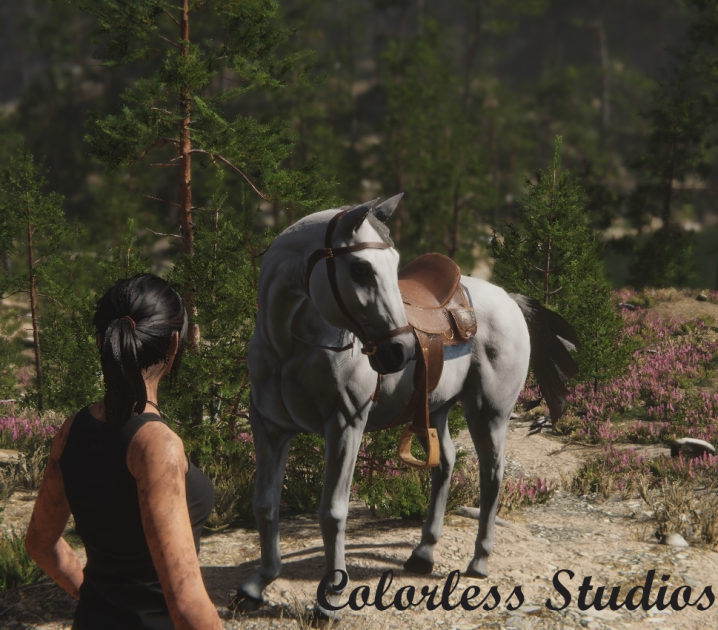
          </a>
        

    === ":material-account-voice: Tester Feedback"

        

          <iframe src="https://www.youtube.com/embed/rxMbD1j6Wq4?si=dhbv4CtgpaOGfr4k" allowfullscreen></iframe>
        

## Extra Additions

!!! danger no-icon ":material-tire: Vehicle Wheel Deformation (Physics R&D)"

    In addition to the core project, I developed a concept for vehicle wheel deformation. Although this feature was not integrated into the final demo for the showcase, it represents a significant technical milestone in my exploration of physics-based mechanics.

    === ":material-video: Technical Demo"

        

          <iframe src="https://www.youtube.com/embed/SycE8ZyFlnA?si=PEhuYCbG2I11AEeO" allowfullscreen></iframe>
        

    === ":material-image-multiple: Mesh & Physics Screenshots"

        

        -   [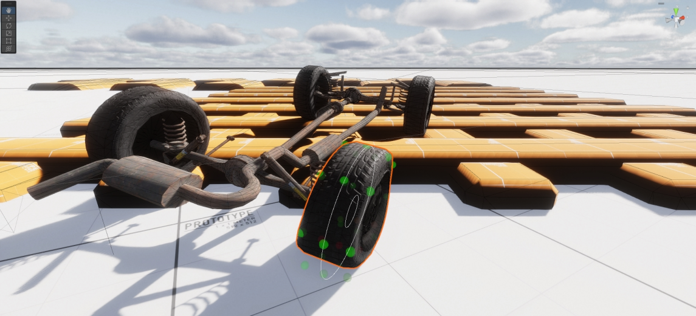](../img/portfolio/Deformation.png){ .glightbox }

        -   [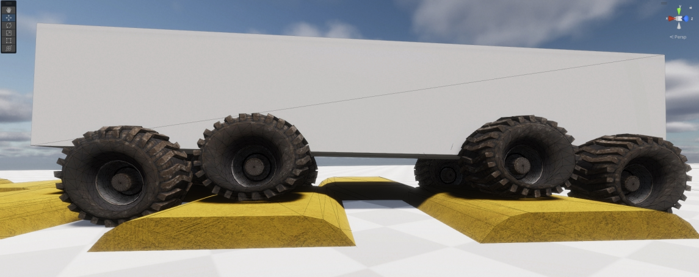](../img/portfolio/Deformation2.png){ .glightbox }

        

!!! danger no-icon ":material-axe: Advanced Tree-Chopping & Particle System"

    I took the basic demo mechanics and leveled up the tree-chopping system. I linked it to a proper inventory and added advanced particle effects, including environment-aware collisions. This was a direct evolution of the dynamic blood splatter logic I built for my previous horror project in 2019.

    

      <iframe src="https://www.youtube.com/embed/pdudZyNDIB8?si=Ps6UwEXumkDe6vC9" allowfullscreen></iframe>
    

[Source code](https://github.com/ArturHKBA/ArturHKBA.github.io/tree/main/assets/resources/unity/deformation)

## Inverse Kinematics

!!! danger no-icon ":material-shoe-print: Procedural Foot Placement & Terrain Adaptation"

    In many third-person and full-body FPS games, walking on stairs or uneven terrain often leads to floating or clipping feet. While often just a visual glitch, it can actually break locomotion if the offset is too high. Instead of asking animators for hundreds of edge-case animations—which limits level design—I developed a procedural IK (Inverse Kinematics) system. Using real-time ray-scanning, the system dynamically adjusts foot placement to keep movement grounded and fluid, regardless of the terrain.

    === ":material-compare-horizontal: Before & After Comparisons"

        

          

            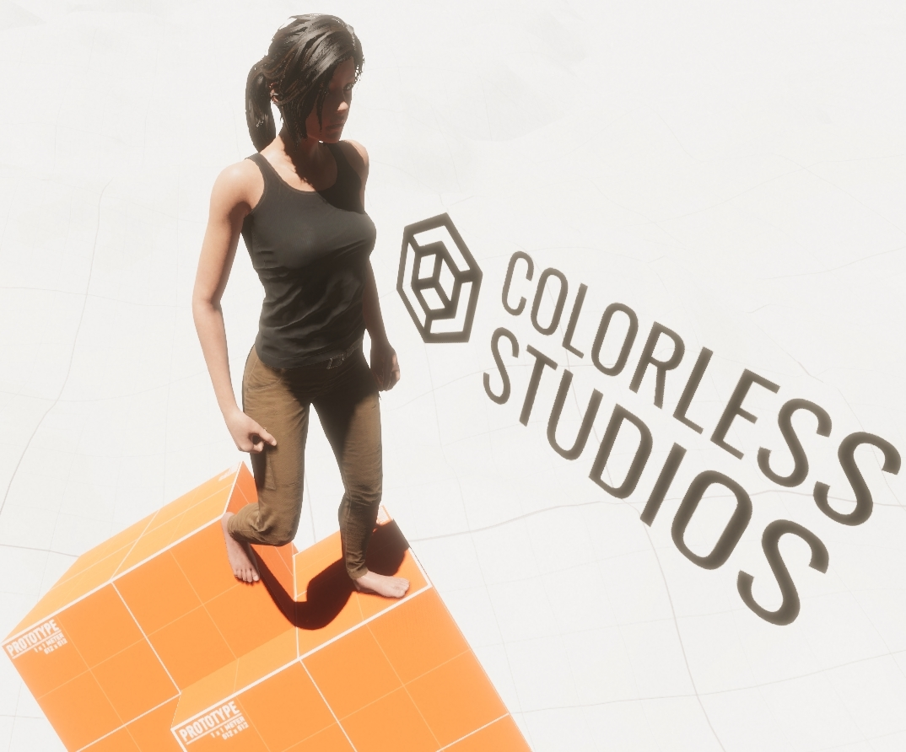
            

              IK ON
            

            

              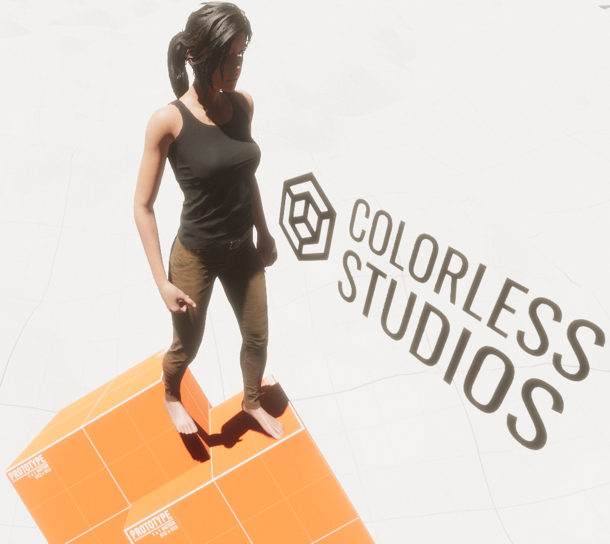
              IK OFF
            

            

            <input type="range" min="0" max="100" value="50" oninput="this.parentElement.style.setProperty('--slider-pos', this.value + '%');">
          

          

            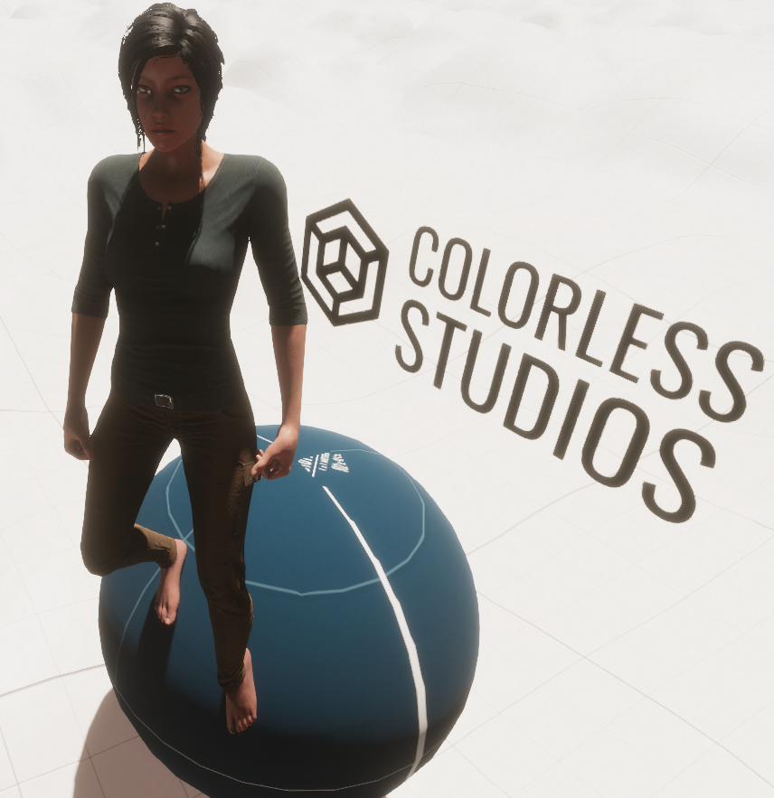
            

              IK ON
            

            

              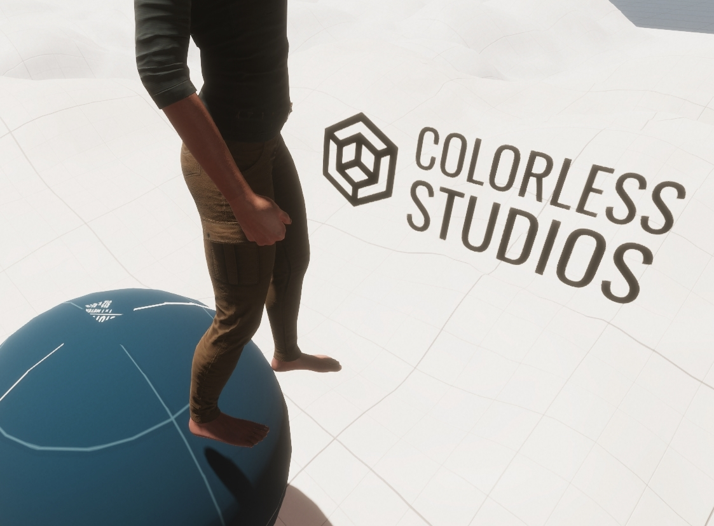
              IK OFF
            

            

            <input type="range" min="0" max="100" value="50" oninput="this.parentElement.style.setProperty('--slider-pos', this.value + '%');">
          

        

    === ":material-walk: Locomotion Preview"

        

          <video controls>
            <source src="../vid/IK_Preview.mp4" type="video/mp4">
          </video>
        

    === ":material-robot-outline: AI Terrain Adaptation"

        

          <video controls>
            <source src="../vid/IK_AI.mp4" type="video/mp4">
          </video>
        

    === ":material-lightbulb-on-outline: Technical Reference"

        My approach to this system was significantly influenced by this specific demonstration, which guided my development of the ray-scanning logic:

        

          <iframe src="https://www.youtube.com/embed/PryJ3CpHcXQ?si=KaBuUx3wL3ZQ3H1T" allowfullscreen></iframe>
        

    

      :material-github: <a href="https://github.com/ArturHKBA/ArturHKBA.github.io/tree/main/assets/resources/unity/inversekinematics" target="_blank">Inspect Full Source Code (C# Scripts)</a>
    

## HDRP Lighting & Atmosphere Study (Backrooms)

!!! danger no-icon ":material-lamp-outline: Real-Time Ray Tracing & Volumetric Lighting Progression"

    To further master the High Definition Render Pipeline (HDRP), I undertook a lighting and environment project by recreating a scene from the "Backrooms." This project allowed me to explore advanced features such as real-time ray tracing, volumetric lighting, and performance optimization. While the scene focused primarily on lighting and atmosphere rather than final set details (like decals or debris), it successfully captured the unsettling, sterile aesthetic of the original concept. Switch between the three stages below to inspect the lighting progression:

    

      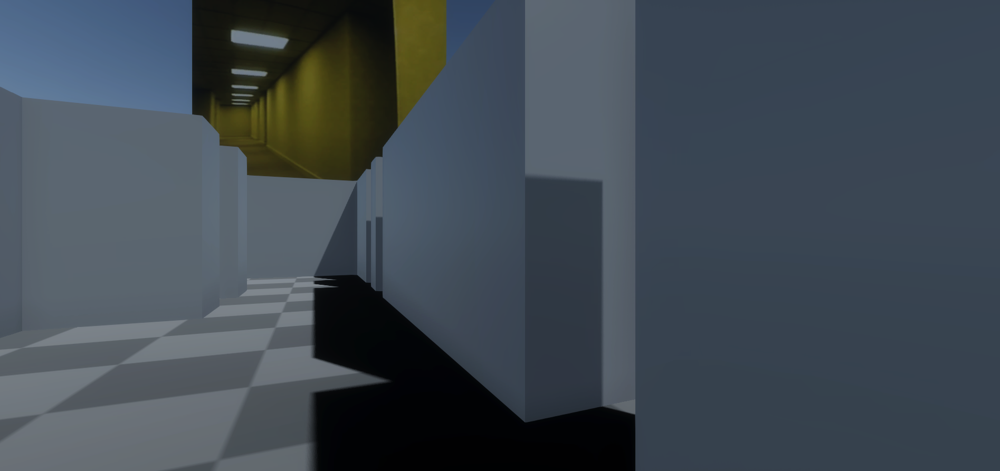
      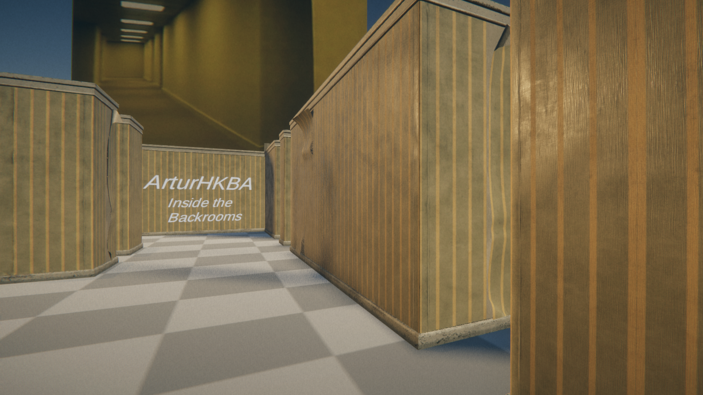
      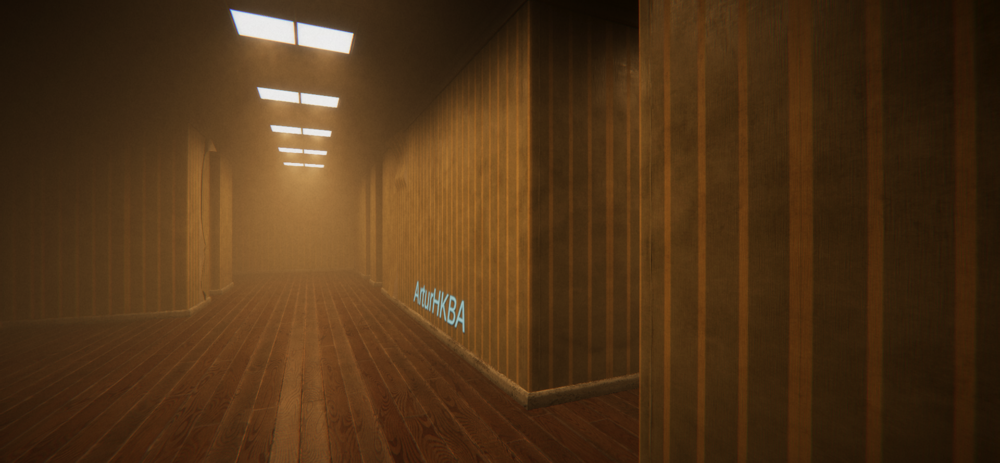
    

    

      <button type="button" class="stage-btn" onclick="const w = this.closest('.admonition'); w.querySelector('.stage-viewer').dataset.active = '1'; w.querySelectorAll('.stage-btn').forEach(b => b.classList.remove('active')); this.classList.add('active');">1. Greybox Blockout</button>
      <button type="button" class="stage-btn" onclick="const w = this.closest('.admonition'); w.querySelector('.stage-viewer').dataset.active = '2'; w.querySelectorAll('.stage-btn').forEach(b => b.classList.remove('active')); this.classList.add('active');">2. Base Lighting</button>
      <button type="button" class="stage-btn active" onclick="const w = this.closest('.admonition'); w.querySelector('.stage-viewer').dataset.active = '3'; w.querySelectorAll('.stage-btn').forEach(b => b.classList.remove('active')); this.classList.add('active');">3. Final HDRP</button>
    

## Content Creation & 3D Thumbnail Design

!!! danger no-icon ":material-broadcast: Multi-Platform Streaming & Custom Blender Branding"

    In 2024, I expanded into streaming on Twitch and TikTok. Managing multiple platforms meant balancing content creation, video editing, and community moderation—all while staying hands-on with my branding. I designed and rendered my own thumbnails in Blender, using custom props to ensure a unique visual style.

    === ":material-cube-outline: Blender Viewport Setup"

        

          <a href="../img/portfolio/Saga_Blend.png" class="glightbox" style="display: block; width: 100%; height: 100%;">
            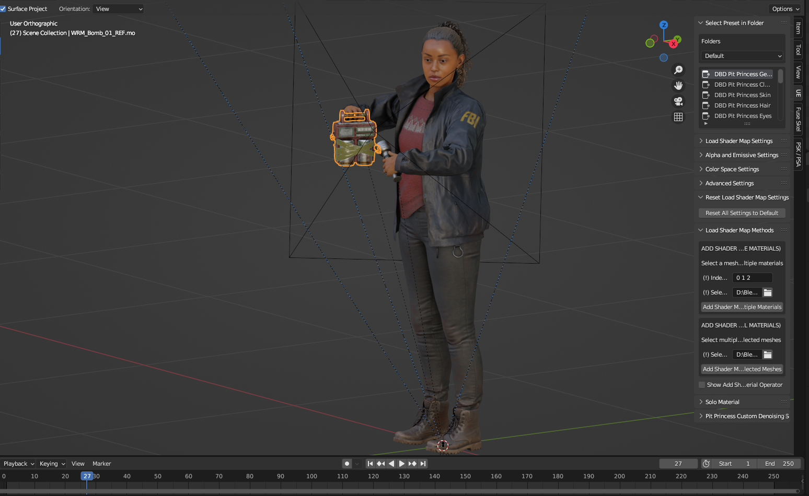
          </a>
        

    === ":material-image-check-outline: Final Rendered Thumbnail"

        

          <a href="../img/portfolio/Saga_Final.png" class="glightbox" style="display: block; width: 100%; height: 100%;">
            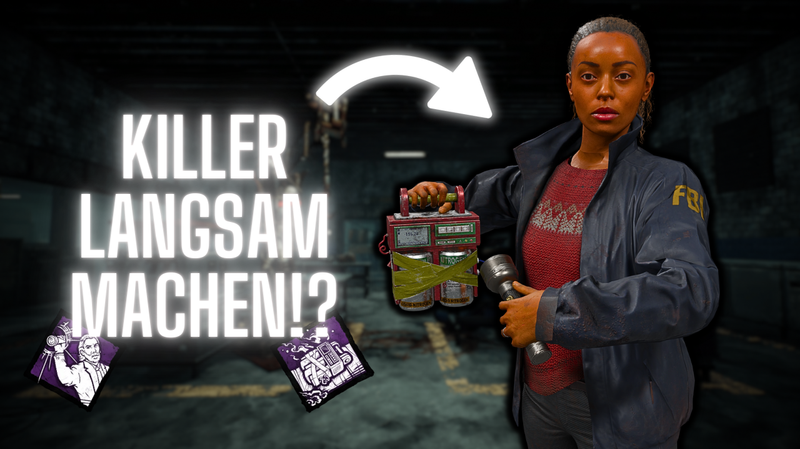
          </a>
        

    === ":material-youtube: Featured Video"

        

          <iframe src="https://youtube.com" allowfullscreen></iframe>
        

    

      :material-youtube: <a href="https://youtube.com" target="_blank">YouTube</a>
      •
      :material-twitch: <a href="https://twitch.tv" target="_blank">Twitch</a>
      •
      :material-music-note: <a href="https://tiktok.com" target="_blank">TikTok</a>
    

