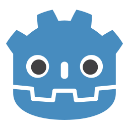
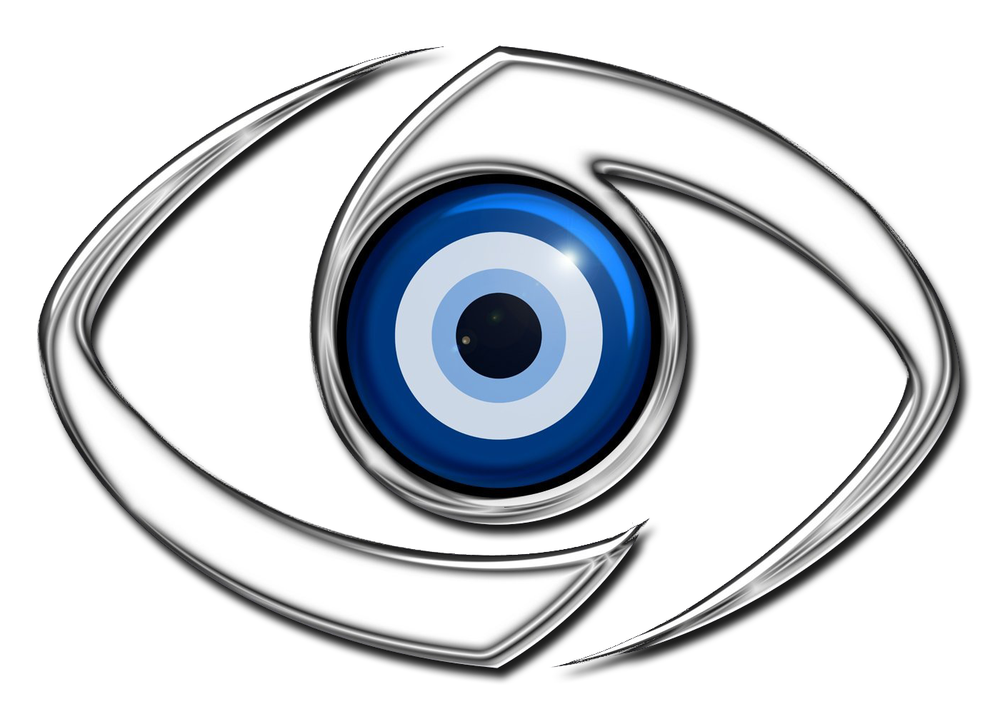
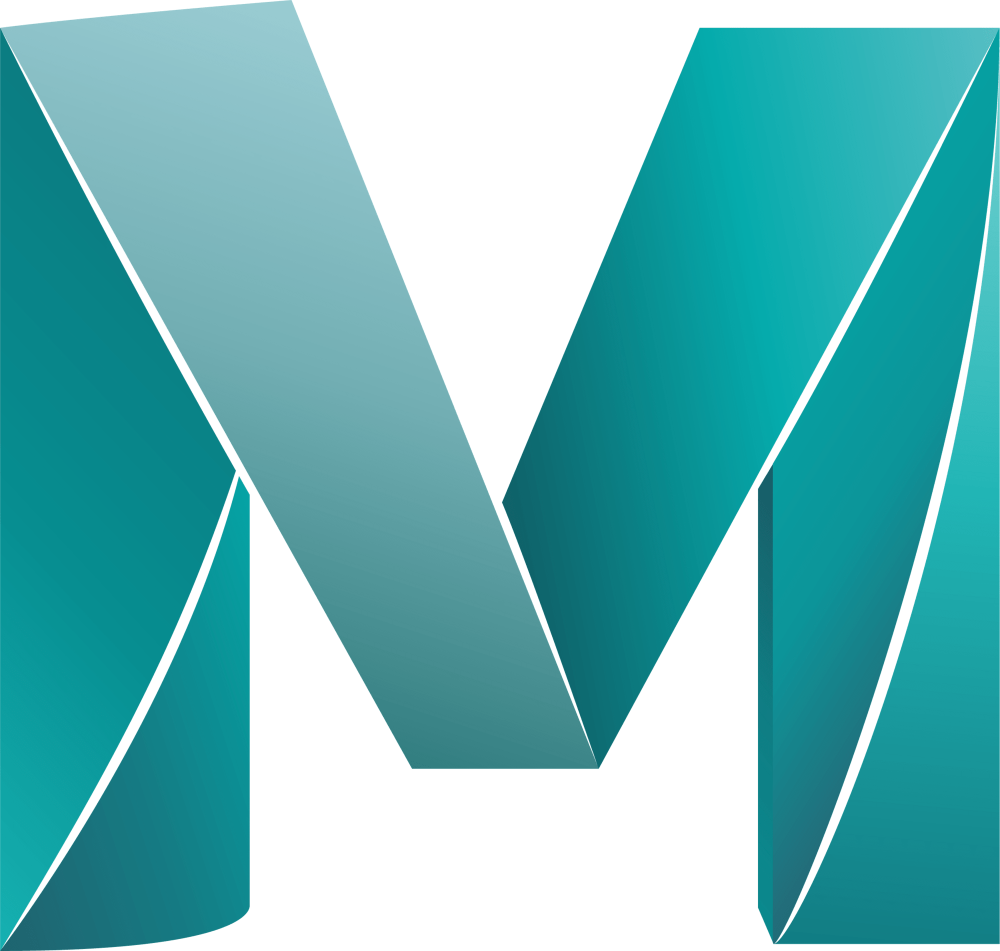
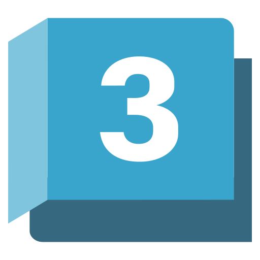
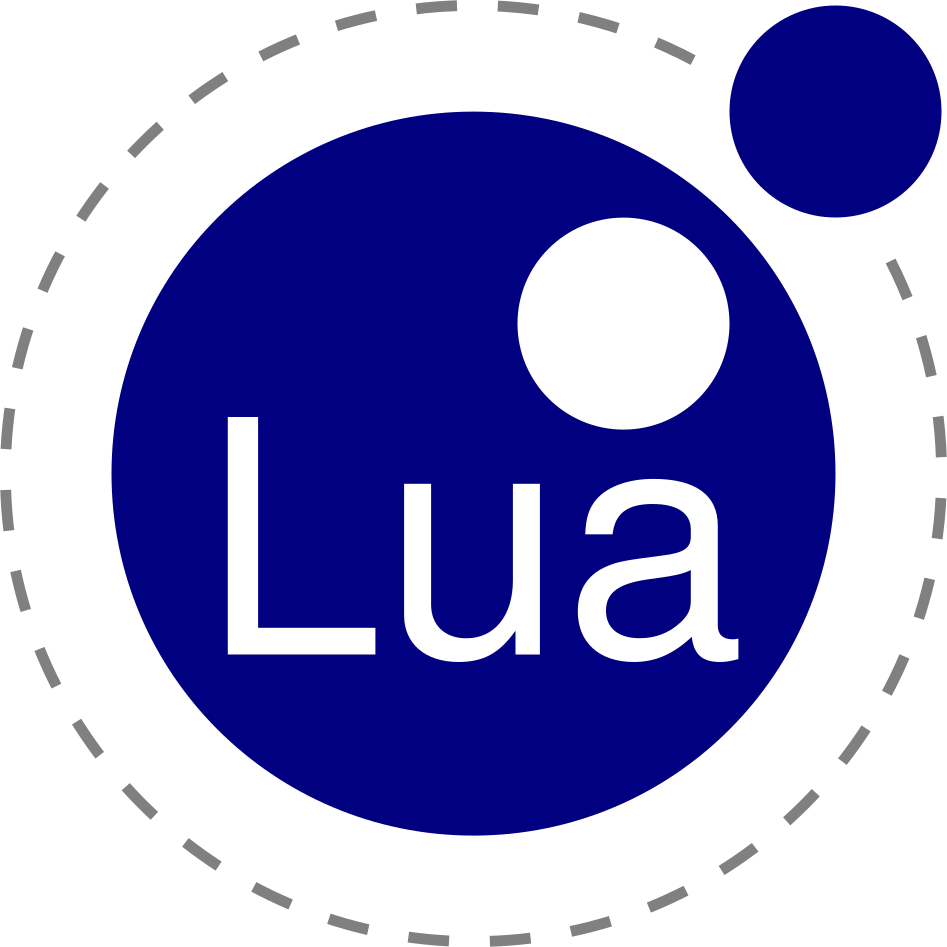
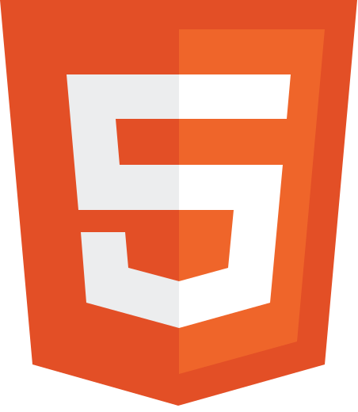
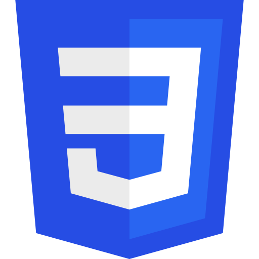
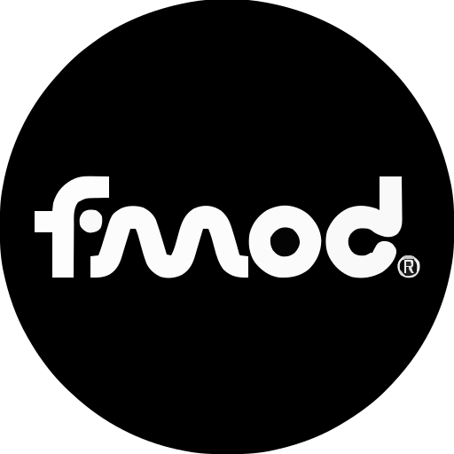
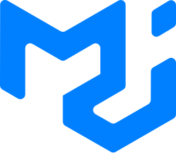

## Skills & Tools

# Learned by coding all night and debugging all day!

As a full-stack Software Engineer, I specialize in building scalable web applications using modern technologies. I'm also expanding my expertise into game development, 3D modeling, and robust software architecture.

Game Engines

 Unity Engine 5-7
 Godot Engine
 Unreal Engine 3-5
 CryEngine 3

3D Modeling & Art

 Blender
 Autodesk Maya
 3ds Max
 Substance 3D Modeler
 Substance 3D Painter
 Substance 3D Designer
 ZModeler

Programming Languages

 C#
 Python
 Java
 JavaScript
 Lua
 HTML
 CSS

Miscellaneous & Tools

 FMOD Studio
 Material UI
 Git
 GitHub

