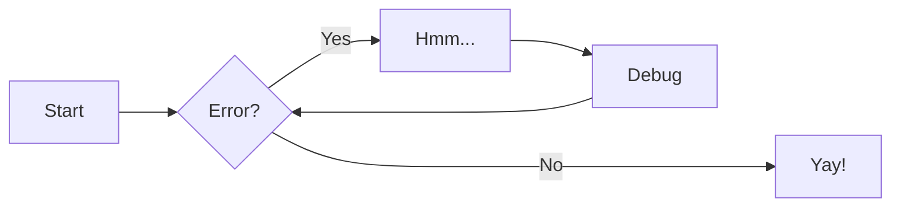

# Get started

For full documentation visit [zensical.org](https://zensical.org/docs/).

## Commands

- [`zensical new`][new] - Create a new project
- [`zensical serve`][serve] - Start local web server
- [`zensical build`][build] - Build your site

  [new]: https://zensical.org/docs/usage/new/
  [serve]: https://zensical.org/docs/usage/preview/
  [build]: https://zensical.org/docs/usage/build/

## Examples

### Admonitions

> Go to [documentation](https://zensical.org/docs/authoring/admonitions/)

!!! note

    This is a **note** admonition. Use it to provide helpful information.

!!! warning

    This is a **warning** admonition. Be careful!

### Details

> Go to [documentation](https://zensical.org/docs/authoring/admonitions/#collapsible-blocks)

??? info "Click to expand for more info"

    This content is hidden until you click to expand it.
    Great for FAQs or long explanations.

## Code Blocks

> Go to [documentation](https://zensical.org/docs/authoring/code-blocks/)

```python hl_lines="2" title="Code blocks"
def greet(name):
    print(f"Hello, {name}!") # (1)!

greet("Python")
```

1.  > Go to [documentation](https://zensical.org/docs/authoring/code-blocks/#code-annotations)

    Code annotations allow to attach notes to lines of code.

Code can also be highlighted inline: `#!python print("Hello, Python!")`.

## Content tabs

> Go to [documentation](https://zensical.org/docs/authoring/content-tabs/)

=== "Python"

    ``` python
    print("Hello from Python!")
    ```

=== "Rust"

    ``` rs
    println!("Hello from Rust!");
    ```

## Diagrams

> Go to [documentation](https://zensical.org/docs/authoring/diagrams/)



## Footnotes

> Go to [documentation](https://zensical.org/docs/authoring/footnotes/)

Here's a sentence with a footnote.[^1]

Hover it, to see a tooltip.

[^1]: This is the footnote.

## Formatting

> Go to [documentation](https://zensical.org/docs/authoring/formatting/)

- ==This was marked (highlight)==
- ^^This was inserted (underline)^^
- ~~This was deleted (strikethrough)~~
- H~2~O
- A^T^A
- ++ctrl+alt+del++

## Icons, Emojis

> Go to [documentation](https://zensical.org/docs/authoring/icons-emojis/)

- :sparkles: `:sparkles:`
- :rocket: `:rocket:`
- :tada: `:tada:`
- :memo: `:memo:`
- :eyes: `:eyes:`

## Maths

> Go to [documentation](https://zensical.org/docs/authoring/math/)

$$
\cos x=\sum_{k=0}^{\infty}\frac{(-1)^k}{(2k)!}x^{2k}
$$

!!! warning "Needs configuration"
Note that MathJax is included via a `script` tag on this page and is not
configured in the generated default configuration to avoid including it
in a pages that do not need it. See the documentation for details on how
to configure it on all your pages if they are more Maths-heavy than these
simple starter pages.

<script id="MathJax-script" src="https://unpkg.com/mathjax@3/es5/tex-mml-chtml.js"></script>
<script>
  window.MathJax = {
    tex: {
      inlineMath: [["\\(", "\\)"]],
      displayMath: [["\\[", "\\]"]],
      processEscapes: true,
      processEnvironments: true
    },
    options: {
      ignoreHtmlClass: ".*|",
      processHtmlClass: "arithmatex"
    }
  };

  document$.subscribe(() => {
    MathJax.startup.output.clearCache()
    MathJax.typesetClear()
    MathJax.texReset()
    MathJax.typesetPromise()
  })
</script>

## Task Lists

> Go to [documentation](https://zensical.org/docs/authoring/lists/#using-task-lists)

- [x] Install Zensical
- [x] Configure `zensical.toml`
- [x] Write amazing documentation
- [ ] Deploy anywhere

## Tooltips

> Go to [documentation](https://zensical.org/docs/authoring/tooltips/)

[Hover me][example]

[example]: https://example.com "I'm a tooltip!"

# **MY PROJECTS**

### **1. 2016 – 2019 | Unity Engine**

**Foundational projects and initial experiments in game development.**

##### Simple AI & Pathfinding:

##### Procedural VFX (Particle Systems):

##### First-Person Animation:

##### Immersive Gameplay Mechanics (Player States):

##### Technical Optimization (Graphics Menu):

##### Cross-Platform Input Support:

**Note:**

### **2. 2019 – 2021 | Modding Frameworks**

**Development of custom systems and multiplayer frameworks**

My key Contributions:

##### Realistic Inventory & Weapon Restriction:

##### Emergency lighting system Overhaul:

##### Dynamic fire/flame System:

##### Mask Shop System:

##### Immersive Armory & Animation Syncing:

##### Other projects & world building:

##### Custom Mapping & Level Design:

**Note:**

### **3. 2022 – 2024 | Unity Engine**

**Advanced school assignments and specialized technical explorations.**

Overview:

##### Demos

##### Extra Additions:

##### Inverse Kinematics:

##### 4. 2025 – Present | Current Works

**Ongoing focus on complex mechanics and immersive environments.**

Overview:

##### Weapon System Development in Unity:

##### VR Optimization & VRChat World Building:

**Note:**

# Colors

Zensical allows to change the color palette of your documentation site through configuration to fit your brand's identity. If you want to go beyond that, you can also define [custom colors](#custom-colors).

## Configuration

### Color palette

#### Color scheme

Zensical supports two color schemes: a **light mode**, which is called `default`, and a **dark mode**, which is called `slate`. The color scheme can be set via configuration:

```toml
[project.theme.palette]
scheme = "default"
```

```yaml
theme:
  palette:
    scheme: default
```

Click on a tile to preview the color scheme:

`default` `slate`

#### Primary color

The primary color is used for text links, and in the `classic` theme, for the header and the sidebar. In order to change the primary color, set the setting to a valid color name:

```toml
[project.theme]
palette.primary = "indigo"
```

```yaml
theme:
  palette:
    primary: indigo
```

Click on a tile to preview the primary color:

`red` `pink` `purple` `deep purple` `indigo` `blue` `light blue` `cyan` `teal` `green` `light green` `lime` `yellow` `amber` `orange` `deep orange` `brown` `grey` `blue grey` `black` `white`

See our guide below to learn how to set [custom colors](#custom-colors).

#### Accent color

The accent color is used to denote elements that can be interacted with, e.g. hovered links, buttons, and scrollbars. It can be changed in your configuration by choosing a valid color name:

```toml
[project.theme]
palette.accent = "indigo"
```

```yaml
theme:
  palette:
    accent: indigo
```

Click on a tile to preview the accent color:

`red` `pink` `purple` `deep purple` `indigo` `blue` `light blue` `cyan` `teal` `green` `light green` `lime` `yellow` `amber` `orange` `deep orange`

See our guide below to learn how to set [custom colors](#custom-colors).

### Color palette toggle

Offering a light and dark color palette makes your documentation pleasant to read at different times of the day, so the user can choose accordingly. Add the following lines to allow users to switch between light and dark mode:

```toml
# Palette toggle for light mode
[[project.theme.palette]] # (1)!
scheme = "default"
toggle.icon = "lucide/sun"
toggle.name = "Switch to dark mode"

# Palette toggle for dark mode
[[project.theme.palette]]
scheme = "slate"
toggle.icon = "lucide/moon"
toggle.name = "Switch to light mode"
```

1. Note that the `theme.palette` setting is defined as a list.

```yaml
theme:
  palette: # (1)!
    # Palette toggle for light mode
    - scheme: default
      toggle:
        icon: lucide/sun
        name: Switch to dark mode

    # Palette toggle for dark mode
    - scheme: slate
      toggle:
        icon: lucide/moon
        name: Switch to light mode
```

1. Note that the `theme.palette` setting is now defined as a list.

You can use any icon from an [available icon set](https://zensical.org/docs/authoring/icons-emojis/#included-icon-sets) for the toggle icon.

This configuration will render a color palette toggle next to the search bar. Note that you can also define separate settings for [`primary`](#primary-color) and [`accent`](#accent-color) per color palette.

The following properties must be set for each toggle:

**`icon`**

This property must point to a valid icon path referencing any icon bundled with the theme, or the build will not succeed. Some popular combinations in addition to the ones above:

- \+ – `lucide/sun` + `lucide/moon`
- \+ – `lucide/toggle-left` + `lucide/toggle-right`

**`name`**

This property is used as the toggle's `title` attribute and should be set to a discernable name to improve accessibility. It's rendered as a [tooltip](https://zensical.org/docs/authoring/tooltips/index.md).

### System preference

Each color palette can be linked to the user's system preference for light and dark appearance by using a media query. Simply add a `media` property next to the `scheme` setting in the configuration:

```toml
# Palette toggle for light mode
[[project.theme.palette]]
media = "(prefers-color-scheme: light)"
scheme = "default"
toggle.icon = "lucide/sun"
toggle.name = "Switch to dark mode"

# Palette toggle for dark mode
[[project.theme.palette]]
media = "(prefers-color-scheme: dark)"
scheme = "slate"
toggle.icon = "lucide/moon"
toggle.name = "Switch to light mode"
```

```yaml
theme:
  palette:
    # Palette toggle for light mode
    - media: "(prefers-color-scheme: light)"
      scheme: default
      toggle:
        icon: lucide/sun
        name: Switch to dark mode

    # Palette toggle for dark mode
    - media: "(prefers-color-scheme: dark)"
      scheme: slate
      toggle:
        icon: lucide/moon
        name: Switch to light mode
```

When the user first visits your site, the media queries are evaluated in the order of their definition. The first media query that matches selects the default color palette.

#### Automatic light / dark mode

Zensical has support for automatic light / dark mode, delegating color palette selection to the user's operating system. Add the following lines to your configuration:

```toml
# Palette toggle for automatic mode
[[project.theme.palette]]
media = "(prefers-color-scheme)"
toggle.icon = "lucide/sun-moon"
toggle.name = "Switch to light mode"

# Palette toggle for light mode
[[project.theme.palette]]
media = "(prefers-color-scheme: light)"
scheme = "default"
toggle.icon = "lucide/sun"
toggle.name = "Switch to dark mode"

# Palette toggle for dark mode
[[project.theme.palette]]
media = "(prefers-color-scheme: dark)"
scheme = "slate"
toggle.icon = "lucide/moon"
toggle.name = "Switch to system preference"
```

```yaml
theme:
  palette:
    # Palette toggle for automatic mode
    - media: "(prefers-color-scheme)"
      toggle:
        icon: lucide/sun-moon
        name: Switch to light mode

    # Palette toggle for light mode
    - media: "(prefers-color-scheme: light)"
      scheme: default # (1)!
      toggle:
        icon: lucide/sun
        name: Switch to dark mode

    # Palette toggle for dark mode
    - media: "(prefers-color-scheme: dark)"
      scheme: slate
      toggle:
        icon: lucide/moon
        name: Switch to system preference
```

1. You can also define separate settings for [`primary`](#primary-color) and [`accent`](#accent-color) per color palette, i.e. different colors for light and dark mode.

Zensical will now change the color palette each time the operating system switches between light and dark appearance, even when the user doesn't reload the site.

## Customization

### Custom colors

Zensical implements colors using [CSS variables](https://developer.mozilla.org/en-US/docs/Web/CSS/Using_CSS_custom_properties) (custom properties). If you want to customize the colors beyond the palette (e.g. to use your brand-specific colors), you can add an [additional style sheet](https://zensical.org/docs/customization/#additional-css) and tweak the values of the CSS variables.

First, set the [`primary`](#primary-color) or [`accent`](#accent-color) values in `mkdocs.yml` to `custom`, to signal to the theme that you want to define custom colors, e.g., when you want to override the `primary` color:

```toml
[project.theme.palette]
primary = "custom"
```

```yaml
theme:
  palette:
    primary: custom
```

Let's say you're **YouTube**, and want to set the primary color to your brand's palette. Just add this CSS and make sure that it is included in the `extra_css` setting in your configuration:

```css
:root > * {
  --md-primary-fg-color: #ee0f0f;
  --md-primary-fg-color--light: #ecb7b7;
  --md-primary-fg-color--dark: #90030c;
}
```

```toml
[project]
extra_css = [
  "stylesheets/extra.css",
]
```

```yaml
extra_css:
  - stylesheets/extra.css
```

### Custom color schemes

Besides overriding specific colors, you can create your own, named color scheme by wrapping the definitions in a `[data-md-color-scheme="..."]` [attribute selector](https://www.w3.org/TR/selectors-4/#attribute-selectors), which you can then set via your configuration as described in the [color schemes](#color-scheme) section:

```css
[data-md-color-scheme="youtube"] {
  --md-primary-fg-color: #ee0f0f;
  --md-primary-fg-color--light: #ecb7b7;
  --md-primary-fg-color--dark: #90030c;
}
```

```toml
[project]
theme.palette.scheme = "youtube"

extra_css = [
  "stylesheets/extra.css",
]
```

```yaml
theme:
  palette:
    scheme: youtube
extra_css:
  - stylesheets/extra.css
```

Additionally, the `slate` color scheme defines all of it's colors via `hsla` color functions and deduces its colors from the `--md-hue` CSS variable. You can tune the `slate` theme with:

```css
[data-md-color-scheme="slate"] {
  --md-hue: 210; /* (1)! */
}
```

1. The `hue` value must be in the range of `[0, 360]`
